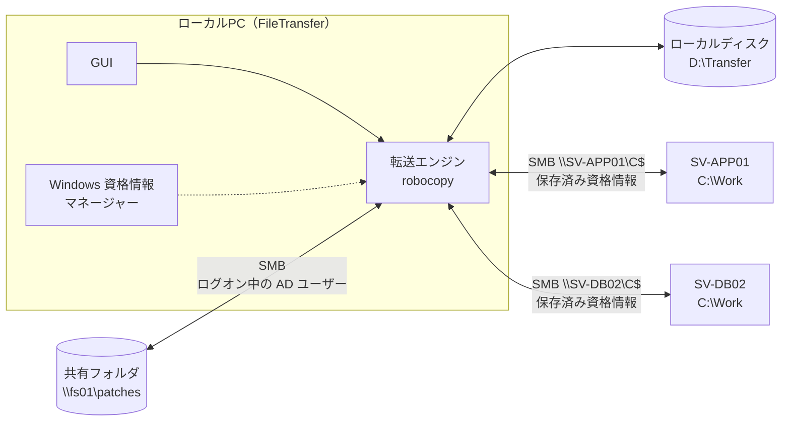
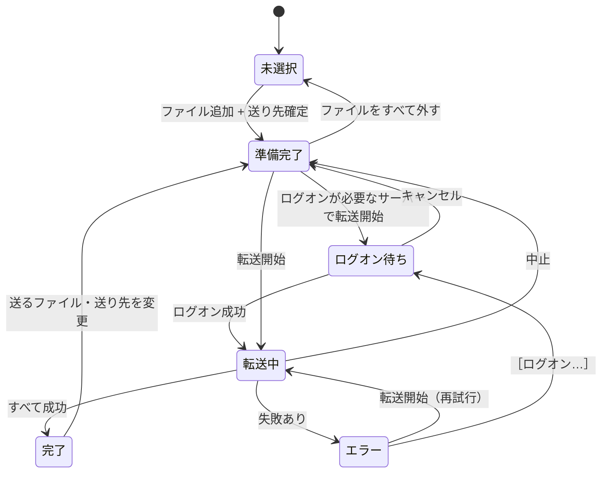
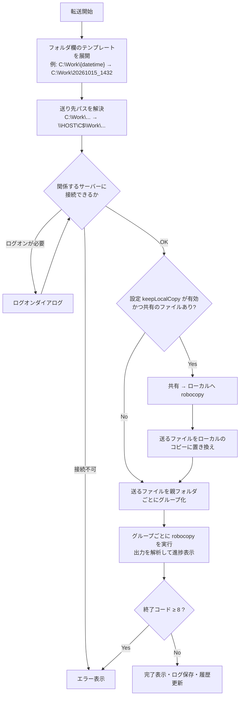
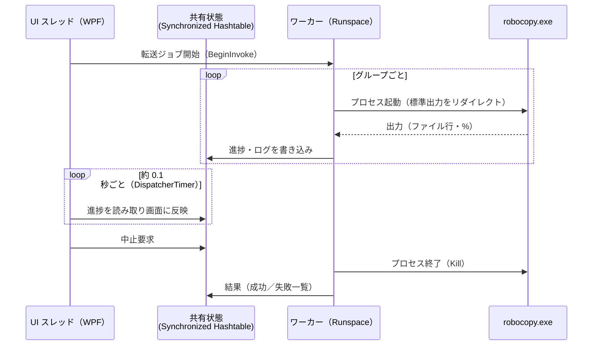

# FileTransfer 設計書（ドラフト v0.1）

ファイル転送（共有フォルダ ⇔ ローカル PC ⇔ Windows Server）を、リモートデスクトップのコピー＆ペーストより速く、手軽に行うためのツールの設計書です。

- 作成日: 2026-10-15
- 状態: v1.0 実装済み（実装との差分は本文に反映済み）
- UI モック: [ui-mock.html](ui-mock.html)

---

## 1. 背景と目的

### 1.1 現状の運用

```
共有フォルダ(\\fs01\patches)  ──エクスプローラーでコピペ──▶  ローカルPC
ローカルPC                    ──RDP 越しにコピペ──────────▶  Windows Server (C:\Work\...)
```

### 1.2 課題

| # | 課題 | 原因 |
|---|------|------|
| 1 | RDP 越しのコピー＆ペーストが非常に遅い | RDP のクリップボード転送は RDP の仮想チャネルを通るため、通常のファイル共有（SMB）に比べて大幅に遅いことが多い |
| 2 | 共有フォルダからローカルへのコピーも遅く感じる | エクスプローラーのコピーは 1 ファイルずつ処理し、大容量ファイル向けの最適化（バッファなし I/O）も使わない |
| 3 | 共有フォルダ → サーバーへ直接置くと遅い・認証が通らない | サーバー上（RDP セッション内）から共有にアクセスすると、経路や認証（共有は AD、サーバーはローカルアカウント）が合わない |
| 4 | 手順が多い | 毎回 RDP 接続 → フォルダ作成 → コピペ、を繰り返している |

### 1.3 目的

1. RDP を使わずにファイルを配置できるようにする（SMB で直接転送）
2. 「送るファイル」と「送り先」を、最小限の操作で指定できるシンプルな GUI を提供する
3. ローカル PC・共有フォルダ・サーバーの 3 者間で、どの向きにも転送できるようにする
4. インストール不要（Python 等のランタイムを入れない）で配布できるようにする

---

## 2. 要件

### 2.1 機能要件

| ID | 要件 | 優先度 |
|----|------|--------|
| F-01 | 送るファイルを複数選択し、まとめて転送できる（ファイル／フォルダの混在も可） | 必須 |
| F-02 | 送るファイルは「ファイル選択ダイアログ」「ドラッグ＆ドロップ」「エクスプローラーでコピー → アプリに貼り付け（Ctrl+V）」で追加できる | 必須 |
| F-03 | 送り先は「このPC」（ローカルのパス、または共有フォルダの UNC パス）か「サーバーのホスト名」で指定できる | 必須 |
| F-04 | サーバーへ送るときは、サーバー上のパス（例: `C:\Work`）で送り先フォルダを指定できる | 必須 |
| F-05 | 送り先フォルダ名に日付・時刻のテンプレート（例: `C:\Work\{datetime}` → `C:\Work\20261015_1432`）が使える | 必須 |
| F-06 | ローカルアカウント／AD アカウントのどちらでもサーバーに認証できる。資格情報は保存して次回から入力不要にできる | 必須 |
| F-07 | 転送の進捗（ファイルごと・全体）、速度、残り時間を表示し、中止できる | 必須 |
| F-08 | 送り先とフォルダは履歴から選ぶだけで指定できる | 必須 |
| F-09 | 共有フォルダ → サーバーの転送時、ローカルにもコピーを残せる（設定ファイルで指定） | 推奨 |
| F-10 | 転送完了後、送り先をエクスプローラーで開く／RDP で接続する、をワンクリックで行える | 推奨 |
| F-11 | 転送ログをファイルに残す | 推奨 |

### 2.2 非機能要件

| 項目 | 要件 |
|------|------|
| 導入 | Windows 標準機能のみで動作する。追加ランタイム（Python / Node.js / .NET の追加インストール）不要 |
| 動作環境（クライアント） | Windows 10 / 11（Windows PowerShell 5.1 と .NET Framework 4.x は OS に標準搭載） |
| 動作環境（サーバー） | Windows Server 2012 R2 以降。**サーバー側へのソフト導入は不要** |
| 性能 | RDP クリップボード転送より十分に速いこと。目安はネットワーク帯域に近い速度 |
| セキュリティ | パスワードを設定ファイルやログに平文で残さない。既存の権限以上のアクセスを可能にしない |
| 操作性 | 初めて使う人でも説明なしで使える程度に、画面項目を最小限にする |

### 2.3 スコープ外（v1 では扱わない）

- インターネット越し・ドメイン外（DMZ 等）への転送
- サーバー上でのインストーラー実行などの「配置後の作業」の自動化
- 双方向の同期（ミラーリング）、差分のみの継続同期
- 細かい転送オプション（帯域制限、属性・ACL の複製など）の GUI 設定

---

## 3. 方式検討

### 3.1 転送方式の比較

| 方式 | 速度 | 手軽さ | 必要な前提 | 評価 |
|------|------|--------|-----------|------|
| RDP クリップボード（現状） | ✕ 遅い | ○ | RDP 接続 | 現状の課題そのもの |
| RDP ドライブリダイレクト（`\\tsclient\C`） | △ | △ | RDP 接続、ドライブ共有の許可 | クリップボードよりは速いが、結局 RDP 経由 |
| SMB（`\\HOST\C$`）をエクスプローラーで操作 | ◎ | △ | 445/TCP、サーバーの管理者権限 | 速いが、認証やパス入力が毎回手間 |
| **SMB ＋ robocopy** | ◎ | ◎（GUI でラップ） | 同上 | **採用** |
| PowerShell Remoting（`Copy-Item -ToSession`） | ○ | ○ | WinRM（5985/TCP）有効化 | SMB が使えない環境向けのフォールバック候補（v2 で検討） |
| 市販・フリーの転送ツール | ◎ | ○ | 導入許可・ライセンス | 導入の承認が必要になりやすい |

**採用理由**

- SMB はドメイン内の Windows 間で標準的に使えるファイル共有プロトコルで、サーバー側の追加設定・追加ソフトが基本的に不要。
- robocopy は Windows 標準のコピーコマンドで、リトライ、マルチスレッド（`/MT`）、大容量ファイル向けのバッファなし I/O（`/J`）を備え、終了コードで結果を判定できる。
- 現状 RDP でログオンしているアカウント（＝サーバーの管理者）で SMB 接続するだけなので、新たな権限付与が不要。

### 3.2 ローカル PC を「ハブ」にする構成

すべての転送をローカル PC 上のツールが仲介します。サーバー側でツールを動かしたり、サーバーから共有フォルダへアクセスさせたりはしません。



**この構成にする理由（経験上の「共有→サーバー直接は遅い／認証が通らない」への対策）**

- **認証の分離**: 共有フォルダへはログオン中の AD ユーザーで、サーバーへはサーバーごとに保存した資格情報（ローカルアカウント可）で、それぞれ別々に接続する。Windows の SMB クライアントは「接続先サーバーごと」に別の資格情報を使えるため、AD とローカルアカウントが混在していても問題にならない。
- **ダブルホップ問題の回避**: サーバー上から共有へアクセスする場合に起きる認証の受け渡し（Kerberos のダブルホップ）が発生しない。

### 3.3 共有フォルダ → サーバー の転送方法

ユーザーの想定どおり「一度ローカルを経由する」ことを基本にしつつ、ディスクに書かずに済む方法を既定にします。

| モード | 動き | 使う場面 |
|--------|------|----------|
| **中継（既定）** | robocopy で `\\fs01\...` → `\\HOST\C$\...` を直接コピー。データはローカル PC のメモリを通過するだけで、ローカルディスクには書かない | 通常時 |
| **ローカル保存あり** | ① 共有 → ローカル（`D:\Transfer\<フォルダ名>`）、② ローカル → サーバー の 2 段階 | 設定ファイルで `keepLocalCopy: true` にしたとき。画面には出さない |

中継モードでは「受信（共有→PC）」と「送信（PC→サーバー）」が同時に進むため、2 段階で行うより早く終わることが期待できます（ネットワークは送受信を同時に使えるため）。どちらが速いかは環境に依存するので、導入時に実測して既定値を決めます（[11.2 事前検証](#112-事前検証手順導入前に-5-分で確認)）。

### 3.4 GUI・配布方式の比較

| 方式 | 配布サイズ | 導入 | 開発・保守 | 評価 |
|------|-----------|------|-----------|------|
| **PowerShell ＋ WPF** | 数十 KB | 不要（OS 標準） | スクリプトなので修正しやすい。中身を誰でも確認できる | **採用** |
| C#（.NET Framework 4.8）単体 exe | 数百 KB | 不要（OS 標準） | ビルド環境（Visual Studio 等）が必要 | 有力な代替案。PowerShell が制限された環境ならこちら |
| Electron | 100 MB 以上 | exe 配布 | Node.js の開発環境が必要。中身は結局 robocopy を呼ぶだけ | この用途には過剰 |
| HTA（mshta） | 数十 KB | 不要 | 技術が古く、将来の OS で廃止のリスク | 不採用 |

**PowerShell ＋ WPF を採用**します。

- Windows 10/11 に標準搭載の Windows PowerShell 5.1 と .NET Framework で動くため、何もインストールしなくてよい。
- WPF（XAML）で、標準的な Windows アプリと同等の見た目・操作性（ドラッグ＆ドロップ、標準ファイルダイアログ等）が作れる。
- 必要に応じて `ps2exe` で exe 化もできる（[10. 配布](#10-配布インストール)）。
- 転送エンジン（robocopy）と認証処理（Win32 API）は言語に依存しない設計にしておくので、将来 C# に移植する場合も設計はそのまま使える。

---

## 4. 全体構成

### 4.1 利用イメージ

| シナリオ | 送るファイル | 送り先 | フォルダ | 操作 |
|----------|-------------|--------|---------|------|
| A. パッチをサーバーへ配置（最頻） | `\\fs01\patches\2026-10\*.msu` | `SV-APP01` | `C:\Work\{datetime}` | ＋でファイルを選ぶ → 送り先を履歴から選ぶ → 転送開始 |
| B. 共有からローカルへ取得 | `\\fs01\release\app\setup.exe` | `このPC` | `D:\Transfer\{date}` | 送り先を「このPC」にして転送開始 |
| C. ローカルのファイルを共有へ | `C:\Users\...\Downloads\config.zip` | `このPC` | `\\fs01\work\yamada\{date}` | ドラッグ＆ドロップ → 転送開始 |
| D. サーバーのログをローカルへ回収 | `\\SV-APP01\C$\Logs\app.log` | `このPC` | `D:\Transfer\{date}_SV-APP01` | ファイル選択ダイアログで `\\SV-APP01\C$\Logs` を開いて選ぶ → 転送開始 |

送るファイルは「パス（ローカルパスまたは UNC パス）のリスト」として扱うため、どこにあるファイルでも同じ操作で送れます。送り先は「このPC」か「サーバーのホスト名」の 2 種類だけで、共有フォルダは「このPC から見えるパス（`\\fs01\...`）」として扱います。

---

## 5. 画面設計

モック: [ui-mock.html](ui-mock.html)（ブラウザで開くと、画面の操作と状態遷移を確認できます）

### 5.1 メイン画面

小さめのウィンドウ 1 枚（既定 400 × 460 px 程度）で完結させます。画面にあるのは **「送るファイル」「送り先（2 つの入力欄）」「転送開始」の 3 つだけ** です。

- 縦方向にだけリサイズでき、広げるとファイル一覧が伸びる。前回の位置と高さを記憶する。
- 接続状態・エラー・完了などのメッセージは、決まった 2 か所（送り先の下の行、ボタンの上の行）に 1 行で出す。

```
┌ FileTransfer ────────────────────── ─ ✕ ┐
│ 送るファイル  3 件・362.7 MB     クリア [＋] │
│ ┌────────────────────────────────────┐ │
│ │ □ KB5031234-x64.msu         312.4 MB │ │
│ │ □ setup_v2.4.1.exe           48.2 MB │ │
│ │ □ config_20261015.zip         2.1 MB │ │
│ │                                      │ │
│ └────────────────────────────────────┘ │
│ 送り先                                   │
│ [● SV-APP01                          ▾] │
│ [C:\Work\{datetime}                  ▾] │
│ → \\SV-APP01\C$\Work\20261015_1432       │ ← 状態の行
│                                          │
│ [              転送開始              ]   │
└──────────────────────────────────────────┘
```

転送中・完了・エラーのときは、一覧の行とボタンまわりだけが変わります。

```
転送中                                  完了
│ ✓ KB5031234-x64.msu   312.4 MB │      │ ✓ 3 件を転送しました（362.7 MB・4.3 秒） 開く RDP │
│ ◌ setup_v2.4.1.exe     48.2 MB │      │ [              転送開始              ]          │
│   config_20261015.zip   2.1 MB │
│ ██████████░░░░░░░░░░░░         │      エラー
│ 62%・104.2 MB/s・残り 2 秒 [中止] │      │ ⚠ SV-WEB01：アクセスが拒否されました ログオン… 詳細 │
                                        │ [              転送開始              ]            │
```

- 転送中の行は、行の背景がそのファイルの進捗バーになる。終わった行には ✓ が付く。
- ボタンの位置は、転送中だけ全体の進捗バーと［中止］に置き換わる。

#### 画面項目

| 項目 | 内容 |
|------|------|
| ファイル一覧 | 名前とサイズだけを表示する（元の場所は、行にマウスを乗せると出る）。ドラッグ＆ドロップや、エクスプローラーでコピーしてから Ctrl+V で追加する。行の × か Delete キーで一覧から外す |
| ＋ | Windows 標準のファイル選択ダイアログ（複数選択可）を、前回開いたフォルダで開く |
| クリア | 一覧を空にする（ファイルがあるときだけ表示） |
| 送り先 | ホスト名か「このPC」を入れる。▾ で履歴から選べる。左端の ● が接続状態を示す（緑：接続OK／黄：ログオンが必要／赤：接続できない）。● をクリックするとログオンダイアログが開き、接続するアカウントを変えられる |
| フォルダ | 送り先のフォルダ。テンプレート（7.3）はこの欄にそのまま書く。▾ で履歴から選べる（「このPC」用とサーバー用で別々の履歴） |
| 状態の行 | 通常は、実際にコピーされる先のフルパスを表示する（誤った場所への配置を防ぐ）。問題があるときはその内容を表示する（「SV-DB02 へのログオンが必要です［ログオン…］」「SV-TEST99 に接続できません」「フォルダ名に使えない文字があります」など） |
| 転送開始 | 送るファイルがあり、送り先が確定しているときだけ押せる（Ctrl+Enter でも開始できる） |
| 結果の行 | 完了時は件数・サイズ・所要時間と、［開く］（エクスプローラーで送り先を開く）、［RDP］（送り先がサーバーのとき）。エラー時は要約と、［ログオン…］［詳細］（エラーの説明とログ） |

**画面に置かないもの**

| 置かないもの | 代わりの手段 |
|--------------|-------------|
| 送り先の種類（サーバー／ローカル／共有）の切り替え | 送り先が「このPC」ならローカル、それ以外はホスト名とみなす。共有フォルダへは「このPC」で `\\fs01\...` と書く |
| フォルダ追加ボタン | ドラッグ＆ドロップ、または Ctrl+V |
| サブフォルダ名の欄・テンプレートの入力補助 | フォルダ欄に直接 `{datetime}` などを書く。履歴に入っているので、2 回目からは選ぶだけ |
| 接続確認ボタン | 送り先を入力・選択したら自動で確認する |
| ログ欄 | エラー時の［詳細］から表示する。ファイルにも保存する |
| ローカルにもコピーを残す、robocopy のオプション、リトライ回数など | 設定ファイル（8 章） |

### 5.2 ログオンダイアログ

```
┌ SV-DB02 にログオン ─────────┐
│ ユーザー名                    │
│ [SV-DB02\Administrator      ] │
│ パスワード                    │
│ [●●●●●●●●                   ] │
│ ☑ 資格情報を保存する          │
│             [キャンセル] [OK] │
└──────────────────────────────┘
```

- 開くタイミングは 3 つ。状態が「ログオンが必要」のときに［転送開始］を押したとき、状態の行の［ログオン…］を押したとき、送り先の ● をクリックしたとき。
- ユーザー名の初期値は、前回そのホストで使ったユーザー名。空欄のときは入力例（`SV-DB02\ユーザー名 または CORP\ユーザー名`）を薄く表示する。
- ［OK］で実際に接続を試み、失敗したら理由をダイアログ内に 1 行で表示する。
- ［転送開始］から開いた場合は、ログオンに成功したらそのまま転送を始める。
- 保存した資格情報は Windows 標準の「資格情報マネージャー」に入るため、エクスプローラーで `\\HOST\C$` を開いたときにも同じ資格情報が使われる。削除は「資格情報マネージャー」から行う（アプリに削除ボタンは置かない）。

### 5.3 状態遷移



---

## 6. 処理フロー（転送開始時）



---

## 7. 機能詳細

### 7.1 送るファイルの指定

- 内部では「フルパスのリスト」として保持する（例: `\\fs01\patches\2026-10\KB5031234-x64.msu`、`C:\Users\yamada\Downloads\config.zip`）。
- 追加方法
  - **＋（ファイル選択ダイアログ）**: `Microsoft.Win32.OpenFileDialog`（`Multiselect = true`）。前回開いたフォルダから開く。共有フォルダやサーバー（`\\SV-APP01\C$\Logs` など）も、このダイアログのアドレスバーや「クイックアクセス」から開ける。
  - **ドラッグ＆ドロップ**: `DataFormats.FileDrop`。フォルダもドロップでき、中身ごと（サブフォルダ含む）送り先にフォルダとしてコピーする。
  - **貼り付け（Ctrl+V）**: エクスプローラーで Ctrl+C したファイル・フォルダを `Clipboard.GetFileDropList()` で取得。今の「コピペ」の習慣をそのまま使える。
- 同じパスの重複追加は無視する。異なる場所にある同名ファイルは、送り先で衝突するため追加時に警告して追加しない。
- 一覧には名前とサイズだけを表示し、元のフルパスはツールチップで表示する。

### 7.2 送り先の指定とパス解決

| 送り先 | フォルダ欄 | 解決後のパス |
|--------|-----------|-------------|
| `SV-APP01` | `C:\Work\{datetime}` | `\\SV-APP01\C$\Work\20261015_1432` |
| `SV-LEGACY01`（設定で `C:\Work` ⇔ `\\SV-LEGACY01\Work$` を定義） | `C:\Work\{datetime}` | `\\SV-LEGACY01\Work$\20261015_1432` |
| `このPC` | `D:\Transfer\{date}` | `D:\Transfer\20261015` |
| `このPC` | `\\fs01\work\yamada\{date}` | `\\fs01\work\yamada\20261015` |

- 送り先が「このPC」以外なら、サーバーのホスト名とみなす。フォルダ欄は「サーバー上のパス」で書き（RDP でサーバーを触るときと同じ感覚）、`X:\path` を `\\HOST\X$\path` に変換する。UNC を直接書いた場合はそのまま使う。
- 送り先を「このPC」とサーバーで切り替えると、フォルダ欄はそれぞれで前回使った値に戻る（サーバー用の `C:\Work\...` がローカルに使われる、といった取り違えを防ぐ）。
- 管理共有（`C$`）が使えないサーバー向けに、設定ファイルで「サーバーパス ⇔ 共有」のマッピングを定義できる（11.1 の対策 B）。
- 送り先フォルダが存在しなければ robocopy が自動作成する。
- 既に存在するフォルダに送る場合はそのまま追加する。同名ファイルは robocopy の既定動作（内容が同じならスキップ、異なれば上書き）に従う。

### 7.3 フォルダ名テンプレート

フォルダ欄に直接書きます（例: `C:\Work\{datetime}`）。

| テンプレート | 展開例（2026-10-15 14:32:10 開始） | 備考 |
|-------------|-------------------------------------|------|
| `{datetime}` | `20261015_1432` | 既定 |
| `{date}` | `20261015` | |
| `{time}` | `1432` | |
| `{now:書式}` | `{now:yyyy-MM-dd_HHmmss}` → `2026-10-15_143210` | .NET の日時書式を自由に指定 |
| `{user}` | `yamada` | Windows のログオンユーザー名 |
| `{host}` | `SV-APP01` | 送り先ホスト名（サーバー時） |

- 固定文字列と組み合わせ可能（例: `C:\Work\{date}_KB5031234` → `C:\Work\20261015_KB5031234`）。
- 階層の途中にも書ける（例: `C:\Work\{date}\patch`）。
- 日時は **転送開始時刻** で確定する（状態の行は現在時刻で表示）。
- ファイル名に使えない文字（`: * ? " < > |`）が含まれる場合は、フォルダ欄の文字を赤くし、状態の行に理由を出して転送開始を押せなくする（`/` は `\` として扱う）。
- 送り先が「このPC」のときは、`%USERPROFILE%` などの環境変数も展開する（サーバーのパスでは展開しない）。

### 7.4 転送エンジン（robocopy）

#### 実行単位

robocopy は「1 つのコピー元フォルダ → 1 つのコピー先フォルダ」単位で動くため、送るファイルを **親フォルダごとにグループ化** して、グループごとに 1 回実行する。

```powershell
# ファイル（同じ親フォルダのものをまとめて 1 回で）
robocopy '\\fs01\patches\2026-10' '\\SV-APP01\C$\Work\20261015_1432' 'KB5031234-x64.msu' 'KB5031235-x64.msu' <共通オプション>

# フォルダ（フォルダ名を送り先に付けて /E）
robocopy 'C:\Build\app' '\\SV-APP01\C$\Work\20261015_1432\app' /E /MT:8 <共通オプション>
```

- ファイル名の引数が多くコマンドラインの長さ上限に近づく場合は、複数回に分割する。
- グループは順番に実行する（同時実行は v2 の複数ホスト配布で検討）。

#### 共通オプション（既定値・設定ファイルで変更可）

| オプション | 目的 |
|-----------|------|
| `/R:2 /W:3` | 失敗時のリトライ 2 回、待機 3 秒（既定の 100 万回・30 秒では固まって見えるため） |
| `/J` | バッファなし I/O。大容量ファイル（既定: 256 MB 以上）を含むグループにだけ付ける |
| `/MT:8` | マルチスレッド。**フォルダ転送（多数ファイル）時のみ**付ける（`/MT` 使用時はファイルごとの % 表示が出ないため、ファイル転送では付けない） |
| `/BYTES /FP /NDL /NJH /NJS` | 進捗解析しやすい出力にする（サイズをバイトで、フルパスで、フォルダ行・ヘッダ・集計なし） |
| `/XJ` | ジャンクションを辿らない（フォルダ転送時の無限ループ防止） |
| `/XX` | 送り先にだけあるファイルを一覧に出さない（コピー対象と誤認しないため。削除もしない） |

#### 進捗の取得

- robocopy の標準出力を読み、「ファイル行（`\t    New File  \t\t<バイト数>\t<フルパス>`）」と「`nn.n%` の進捗」を正規表現で解析する。
- 進捗は改行ではなく CR（`\r`）で上書き出力されるため、`\r` と `\n` の両方を区切りとして読む。
- 出力の文字コード: robocopy は出力をリダイレクトされると、システムの OEM コードページで書く（`/UNICODE` を付けてもパイプには効かないことを実機で確認）。そのため `GetOEMCP()` で得たコードページで読む（日本語環境なら通常 932、「UTF-8 を使用」設定なら 65001）。
- エラー行は表示言語によらず `<番号> (0x<16進>)` の書式なので、この部分から Win32 エラーコードを取り出す。
- 全体進捗 ＝（終わったステップのバイト数 ＋ 今のステップで終わったファイル ＋ 今のファイルのサイズ × %）÷ 合計バイト。送り先と同じ内容でスキップされたファイルは一覧に出ないため、ステップの終わりでまとめて加算する。
- 速度は直近 4 秒の平均、残り時間は（残りバイト ÷ 速度）。
- ログは robocopy の出力をアプリが読み取って、自前のログ（7.7）に書く。

#### 届いたかの確認

robocopy は、存在しないファイル名を指定されてもエラーにしない（終了コード 0〜1 のまま）。そのため、ファイル転送のステップが終わったら、指定したファイルが送り先にあるかを確認し、ないものがあればエラー（「一部のファイルが送り先に届いていません」）にする。

#### 終了コードの判定

| 終了コード | 意味 | 扱い |
|-----------|------|------|
| 0 | コピー対象なし（すべて同一） | 成功（「同一のためスキップ」と表示） |
| 1 | コピー成功 | 成功 |
| 2, 3 | 送り先に余分なファイルあり（＋コピー成功） | 成功 |
| 4〜7 | 不一致あり | 成功（警告をログに記録） |
| 8 以上 | 一部またはすべて失敗 | エラー |

### 7.5 認証処理

#### 接続確認（送り先の入力時・転送開始時）

接続確認のボタンは置かず、送り先の入力が止まってから 0.7 秒後（履歴から選んだときはすぐ）に自動で確認する。

1. `445/TCP` に 2 秒のタイムアウトで TCP 接続を試みる（到達不能なホストで画面が固まらないように）。
2. 送り先の共有（`\\HOST\C$`）にアクセスできるか確認する。
3. 結果を送り先の ● と状態の行に反映する。

| 結果 | ● | 状態の行 |
|------|---|---------|
| アクセス可 | 緑（ツールチップに接続ユーザー名） | `→ \\SV-APP01\C$\Work\20261015_1432` |
| アクセス拒否・ログオン失敗 | 黄 | `SV-DB02 へのログオンが必要です［ログオン…］` |
| 445/TCP に到達不可 | 赤 | `SV-TEST99 に接続できません（ホスト名を確認してください）` |

#### 資格情報の使い方

| 資格情報 | 方法 |
|---------|------|
| ログオン中の AD ユーザー | 何もしない（Windows が自動で Kerberos 認証）。共有フォルダ、および AD ユーザーが管理者になっているサーバー |
| 保存する（既定） | Win32 API `CredWrite` で「Windows 資格情報」（種類: ドメインパスワード、ターゲット: ホスト名）に保存。以後、SMB クライアントが自動で使う。パスワードは Windows が DPAPI で暗号化してユーザーごとに保管する |
| 保存しない | Win32 API `WNetAddConnection2` で今回だけ接続し、アプリ終了時に `WNetCancelConnection2` で切断 |

- `cmdkey` / `net use` コマンドでも同じことができるが、パスワードがコマンドラインに載る（プロセス一覧から見える）ため、API を P/Invoke で呼ぶ。
- 資格情報のターゲット名は入力したホスト名そのもの（大文字に正規化）。短い名前と FQDN は別扱いになる点に注意。
- 1 台のサーバーに対して、同時に 2 つの異なるユーザーでは接続できない（Windows の仕様。エラー 1219）。エクスプローラー等で別ユーザーで接続済みの場合は、その旨を表示し切断を案内する。

### 7.6 エラー処理

転送中のエラーは、ボタンの上の結果の行に要約を 1 行で出し（例: `SV-WEB01：アクセスが拒否されました`）、下表の説明とログは［詳細］で表示する。

| 状況 | 代表的なエラーコード | ［詳細］の説明（案） |
|------|----------------------|----------------------|
| ホストが見つからない／到達できない | 53, 445 接続タイムアウト | 「SV-APP01 に接続できません。ホスト名と、ファイル共有（445番ポート）が許可されているか確認してください。」 |
| ユーザー名・パスワード誤り | 1326, 86 | 「ユーザー名またはパスワードが正しくありません。」 |
| アクセス拒否 | 5 | 「アクセスが拒否されました。管理者権限のあるアカウントか確認してください。ローカルアカウントの場合、組み込みの Administrator 以外は管理共有（C$）に接続できないことがあります（→ 管理者向け手順 11.1）。」 |
| 別の資格情報で接続済み | 1219 | 「SV-APP01 には別のユーザーで接続中です。エクスプローラー等の接続を切断してから再試行してください。」［切断して再試行］ボタン |
| 共有が存在しない | 67 | 「\\SV-APP01\C$ が見つかりません。管理共有が無効になっている可能性があります。」 |
| アカウントのロック・無効 | 1909, 1331 | 「アカウントがロックされているか無効です。」 |
| 送り先の容量不足 | 112 | 「送り先のディスク容量が不足しています。」 |
| ファイル使用中 | 32 | 「ファイルが使用中のためコピーできません: <ファイル名>」 |

- 転送前に、送り先ディスクの空き容量が合計サイズ未満なら警告する。
- 再試行用のボタンは置かない。［転送開始］を押し直すと、送り先に同じ内容で届いているファイルは robocopy がスキップするため、実質的に失敗した分だけが送られる（ただし送り先フォルダに `{datetime}` を使っている場合、時刻が変わると別フォルダになるため、エラー後の再試行では前回の展開結果を引き継ぐ）。
- ［中止］時は robocopy プロセスを終了する。途中まで書かれたファイルは robocopy の仕様上残るため、中止後に「途中のファイルが残っている可能性があります」と表示し、該当ファイル名をログに出す。

### 7.7 ログと履歴

- ログ: `%LOCALAPPDATA%\FileTransfer\logs\yyyyMMdd.log` に 1 日 1 ファイルで追記。転送ごとに「開始時刻・ユーザー・送るファイル・送り先・結果・所要時間・平均速度」と robocopy の出力を記録。保存期間は 30 日（設定可）。
- 履歴（設定ファイルに保存）: 送り先（ホスト名）、フォルダ（「このPC」用とサーバー用で別々）を、それぞれ最近使った順に最大 10 件。ファイル選択ダイアログで最後に開いたフォルダも記憶する。
- 次回起動時は、前回の送り先・フォルダを復元する（送るファイルは復元しない）。

---

## 8. 設定ファイル

設定は次の順に重ねて読む（後のものが優先）。パスワードはどこにも含めない。

1. アプリに組み込みの既定値
2. 配布フォルダの `settings.default.json`（部署で使うサーバーの一覧、`serverShareMappings`、転送オプションなどを管理者が配る）
3. `%APPDATA%\FileTransfer\settings.json`（ユーザーごと）

アプリがユーザーの `settings.json` に書くのは `history`・`last`・`window` だけ。転送オプションなどは書かないので、管理者が `settings.default.json` を更新すれば全員に反映される。ユーザーが自分で `settings.json` に書いた項目は、アプリが保存しても消えずに残る。

`history` は初回だけ `settings.default.json` の値を使い、一度保存した後はユーザーの履歴が優先される（後から配布側に追加したサーバーは、既存ユーザーの履歴には自動では入らない）。

全項目の例:

```json
{
  "version": 1,
  "history": {
    "destinations": ["SV-APP01", "SV-WEB01", "SV-DB02"],
    "serverFolders": ["C:\\Work\\{datetime}", "C:\\Work\\{date}", "D:\\Deploy\\{datetime}"],
    "localFolders": ["D:\\Transfer\\{datetime}", "\\\\fs01\\work\\yamada\\{date}"],
    "lastOpenDir": "\\\\fs01\\patches\\2026-10"
  },
  "last": {
    "destination": "SV-APP01",
    "folder": "C:\\Work\\{datetime}"
  },
  "window": { "left": 200, "top": 160, "height": 460 },
  "serverShareMappings": [
    { "host": "SV-LEGACY01", "serverPath": "C:\\Work", "share": "\\\\SV-LEGACY01\\Work$" }
  ],
  "transfer": {
    "retryCount": 2,
    "retryWaitSec": 3,
    "unbufferedThresholdMB": 256,
    "threadsForFolders": 8,
    "keepLocalCopy": false,
    "localCopyFolder": "D:\\Transfer\\{datetime}"
  },
  "log": {
    "retentionDays": 30
  }
}
```

---

## 9. 内部構成

### 9.1 ファイル構成

```
FileTransfer/
├─ FileTransfer.ps1            … エントリポイント。画面の生成とイベント処理
├─ FileTransfer.bat            … 開発・確認用の起動バッチ（配布先では FileTransfer.exe を使う）
├─ FileTransfer.ico            … アイコン（tools\New-Icon.ps1 で生成）
├─ install.bat                 … インストール／更新（-Uninstall で削除）
├─ settings.default.json       … 配布時の既定設定（サーバーの一覧等）
├─ ui/
│   ├─ Styles.xaml             … 色・ボタンなどの共通スタイル
│   ├─ MainWindow.xaml         … メイン画面
│   ├─ LogonDialog.xaml        … ログオンダイアログ
│   └─ DetailsDialog.xaml      … エラーの［詳細］
├─ lib/
│   ├─ Config.psm1             … 設定・履歴の読み書き
│   ├─ PathResolver.psm1       … テンプレート展開、サーバーパス→UNC 変換、入力チェック
│   ├─ Connection.psm1         … 接続確認、ログオン（資格情報の保存・接続・切断）
│   ├─ TransferEngine.psm1     … 実行計画の作成、robocopy 実行、出力解析、エラー文言
│   ├─ Log.psm1                … ログ出力・古いログの削除
│   ├─ Native.cs               … P/Invoke（GetFileAttributes / WNetAddConnection2 / CredWrite / CredRead など）
│   └─ Models.cs               … ファイル一覧の行（FileItem、変更通知つき）
├─ launcher/Launcher.cs        … FileTransfer.exe のソース（コンソールを出さずに起動する）
├─ tools/
│   ├─ Install.ps1             … install.bat の本体
│   ├─ Build-Launcher.ps1      … csc.exe で FileTransfer.exe をビルド
│   └─ New-Icon.ps1            … FileTransfer.ico を作り直す
├─ tests/
│   ├─ Run-Tests.ps1           … 自動テスト（パス解決・計画・出力解析・実際のローカル転送・中止）
│   └─ Render-Screens.ps1      … 画面を画面外に出して操作し、各状態を PNG に保存する結合テスト
└─ docs/                       … 設計書・UI モック
```

- `lib\*.cs` は起動時に `Add-Type` でコンパイルする。毎回のコンパイルは 1 秒ほどかかるため、ソースのハッシュごとに `%LOCALAPPDATA%\FileTransfer\bin` に DLL をキャッシュする。
- `.ps1` / `.psm1` は BOM 付き UTF-8 で保存する（Windows PowerShell 5.1 は BOM なしの UTF-8 を Shift-JIS として読むため）。`.cs` と `.bat` は ASCII のみにする。

### 9.2 スレッド構成

WPF の画面は UI スレッドで動かし、転送や接続確認は別スレッド（PowerShell の Runspace）で実行して画面が固まらないようにする。



- PowerShell は `-STA` で起動する（WPF の要件）。
- 管理者として実行しない（管理者権限のアプリには、通常権限のエクスプローラーからドラッグ＆ドロップできないため）。

---

## 10. 配布・インストール

### 10.1 配布形態

共有フォルダ（例: `\\fs01\tools\FileTransfer\`）にフォルダごと置き、各自が `install.bat` を実行する。

| 手順 | 内容 |
|------|------|
| `install.bat` | `%LOCALAPPDATA%\Programs\FileTransfer` にコピーし、`FileTransfer.exe`（ランチャー）をその PC でビルドして、デスクトップとスタートメニューにショートカットを作る。管理者権限は不要。もう一度実行すると更新になる |
| `install.bat -Uninstall` | プログラムとショートカットを削除する（設定 `%APPDATA%\FileTransfer` とログは残す） |
| `FileTransfer.bat` | インストールせずに試すとき用。コンソールが一瞬出ることがある |

**ランチャー（FileTransfer.exe）を使う理由**: `powershell.exe -WindowStyle Hidden` で起動すると、コンソールが一瞬表示される。さらに、Windows Terminal が既定のターミナルになっている環境（Windows 11 の既定）では、ターミナルの窓が残ってしまう。ランチャーは「窓なし」で PowerShell を起動するので、コンソールは一切出ない。ランチャーは Windows 標準の .NET Framework に含まれる C# コンパイラ（`csc.exe`）でインストール時にビルドするので、追加のインストールは不要で、ソース（`launcher\Launcher.cs`）も誰でも確認できる。起動後 8 秒以内にスクリプトが異常終了した場合は、ランチャーがメッセージを出す。

### 10.2 注意点

- グループポリシーで PowerShell の実行ポリシーが `AllSigned` に強制されている場合、`-ExecutionPolicy Bypass` は効かないため、スクリプトへのコード署名が必要。
- AppLocker や制約付き言語モード（Constrained Language Mode）が有効な環境では、`Add-Type`（P/Invoke）や WPF が使えないことがある。その場合は C# の exe 版（3.4 の代替案）に切り替える。
- バージョンアップは、共有フォルダ上のファイルを差し替え、`install.bat` を再実行してもらう。（起動時の更新チェックは v2 で検討）

---

## 11. サーバー側の前提条件

### 11.1 前提条件チェックリスト

| # | 条件 | 確認方法 | 満たせない場合 |
|---|------|---------|---------------|
| 1 | クライアント PC からサーバーの 445/TCP に到達できる | `Test-NetConnection SV-APP01 -Port 445` | サーバーの Windows ファイアウォールで「ファイルとプリンターの共有（SMB 受信）」をドメインプロファイルで許可 |
| 2 | 管理共有（`C$`）が有効 | `Test-Path \\SV-APP01\C$` | 対策 B |
| 3 | 接続アカウントがサーバーの管理者 | 同上でアクセスできるか | 下記 |

**アカウント別の注意点（重要）**

| アカウント | `\\HOST\C$` への接続 |
|-----------|---------------------|
| AD アカウント（サーバーの Administrators に所属） | ○ そのまま使える |
| ローカルの組み込み Administrator | ○ 使える（ポリシーで制限されていない場合） |
| ローカルアカウント（Administrators に所属、組み込み Administrator 以外） | ✕ **既定ではアクセス拒否される**（Windows の「UAC のリモート制限」により、リモート接続時は管理者権限が外される） |

3 行目に該当するサーバーがある場合の対策:

- **対策 A**: サーバーのレジストリ `HKLM\SOFTWARE\Microsoft\Windows\CurrentVersion\Policies\System\LocalAccountTokenFilterPolicy` を `1`（DWORD）にする。ローカル管理者のリモート権限制限を解除するため、**セキュリティ担当の承認が必要**。
- **対策 B（推奨）**: サーバー側に転送用の共有を作る（例: `C:\Work` を `Work$` として共有し、該当ローカルユーザーに共有・NTFS の変更権限を付与）。設定ファイルの `serverShareMappings` に登録すれば、ユーザーは今までどおり `C:\Work` と入力するだけで使える。

### 11.2 事前検証手順（導入前に 5 分で確認）

ツールを作る前に、この方式が実環境で使えるか・どれだけ速くなるかを確認します。クライアント PC の PowerShell で実行してください。

```powershell
# 1. ポート到達確認
Test-NetConnection SV-APP01 -Port 445

# 2. 資格情報を登録（ローカルアカウントの場合。パスワードは対話入力）
cmdkey /add:SV-APP01 /user:SV-APP01\Administrator /pass

# 3. 管理共有にアクセスできるか（$ を含むパスはシングルクォートで囲む）
Test-Path '\\SV-APP01\C$\Work'

# 4. 共有 → サーバー（中継）の速度を測定
Measure-Command {
  robocopy '\\fs01\patches\2026-10' '\\SV-APP01\C$\Work\speedtest' 'KB5031234-x64.msu' /J /R:1 /W:1
}

# 5. 比較用: 共有 → ローカル → サーバー（2 段階）
Measure-Command {
  robocopy '\\fs01\patches\2026-10' 'D:\Transfer\speedtest' 'KB5031234-x64.msu' /J /R:1 /W:1
  robocopy 'D:\Transfer\speedtest' '\\SV-APP01\C$\Work\speedtest2' 'KB5031234-x64.msu' /J /R:1 /W:1
}

# 後片付け（検証用フォルダと資格情報の削除）
Remove-Item '\\SV-APP01\C$\Work\speedtest', '\\SV-APP01\C$\Work\speedtest2', 'D:\Transfer\speedtest' -Recurse
cmdkey /delete:SV-APP01
```

同じファイルを RDP のコピー＆ペーストで送った時間と比べると、効果を数字で示せます。

---

## 12. セキュリティ

| 観点 | 対応 |
|------|------|
| パスワードの保管 | アプリの設定・ログには保存しない。保存する場合は Windows 資格情報マネージャー（DPAPI で暗号化、ユーザー単位）に任せる |
| パスワードの受け渡し | コマンドライン引数に載せない（Win32 API を直接呼ぶ） |
| 権限 | 現在 RDP で使っているアカウントで SMB 接続するだけで、新たな権限を必要としない（対策 A を除く） |
| 通信 | SMB 3.x（Windows Server 2012 以降）を使用。サーバー側で SMB 暗号化が有効なら暗号化通信になる |
| サーバー側 | エージェント等のインストール、追加のポート開放は不要（445/TCP はドメイン内で一般的に開いている） |
| 監査 | 誰が・いつ・何を・どこへ送ったかをローカルのログに記録。サーバー側でもファイル共有の監査ログで追跡可能 |
| 資格情報の削除 | 不要になった資格情報は Windows の「資格情報マネージャー」から削除する。ログオンダイアログで別のアカウントを保存すると上書きされる |

---

## 13. 性能について

- RDP のクリップボード転送は RDP の仮想チャネルを通るため、ネットワーク帯域を十分に使えず遅くなりがちです。SMB で直接送ると、一般にネットワーク帯域に近い速度が期待できます。**実際の改善幅は環境によるため、11.2 の手順で実測してください。**
- 共有 → ローカルの転送は、エクスプローラーも SMB を使っているため、**大きなファイル 1 つだけなら速度差は小さいこともあります**。差が出やすいのは以下の場合です。
  - 大容量ファイル: `/J`（バッファなし I/O）が効くことがある
  - 多数の小さいファイル（フォルダ転送）: `/MT`（マルチスレッド）が効く
  - 操作の手間: フォルダを開く・作る・貼り付けるといった手作業がなくなる
- 共有 → サーバーは「中継」が既定（3.3）。ネットワーク経路によっては 2 段階の方が速い場合もあるため、導入時に実測して既定値を決めます。
- 速度に影響しうる要因: ネットワーク帯域（1GbE / 10GbE）、ウイルス対策ソフトのスキャン、SMB 署名（Windows 11 24H2 / Windows Server 2025 では既定で要求されるようになり、スループットに影響する場合がある）、送り先ディスクの性能。

---

## 14. 今後の拡張（v2 以降の候補）

| 優先度 | 機能 | 概要 |
|--------|------|------|
| 高 | 複数サーバーへの一括配布 | ホスト名欄に複数指定（`SV-APP01, SV-APP02`）。共有のファイルは一度ローカルに取得してから並列で配布 |
| 中 | 転送プリセット | 「パッチ配布（SV-APP01〜03 の C:\Work\{date}）」のような組み合わせを保存してワンクリックで呼び出し |
| 中 | ハッシュ検証 | 転送後に SHA-256 を比較（送り先から読み直すため時間は増える） |
| 中 | WinRM フォールバック | SMB（445/TCP）が使えないサーバー向けに `Copy-Item -ToSession` で転送 |
| 低 | 自動更新チェック | 起動時に共有フォルダ上の新しいバージョンを検知して案内 |
| 低 | コマンドライン実行 | `FileTransfer.ps1 -Source ... -Host ... -Folder ...` でバッチ・タスクから呼べるようにする |

---

## 15. 確認したいこと（未決事項）

1. サーバーの管理共有（`C$`）と 445/TCP は、クライアント PC から使える状態か（11.2 の手順で確認）
2. サーバーのローカルアカウントは組み込みの Administrator か、それ以外か（11.1 の対策 A/B の要否）
3. PowerShell の実行ポリシーや AppLocker の制限はあるか（10.2）
4. 共有フォルダとサーバーは同じ拠点・同じネットワークか（中継モードの速度に影響）
5. 複数台へ同じパッチを配るケースはどの程度あるか（v2 の優先度判断）
6. ローカルの既定保存先（`D:\Transfer` で良いか、ダウンロードフォルダ配下が良いか）
