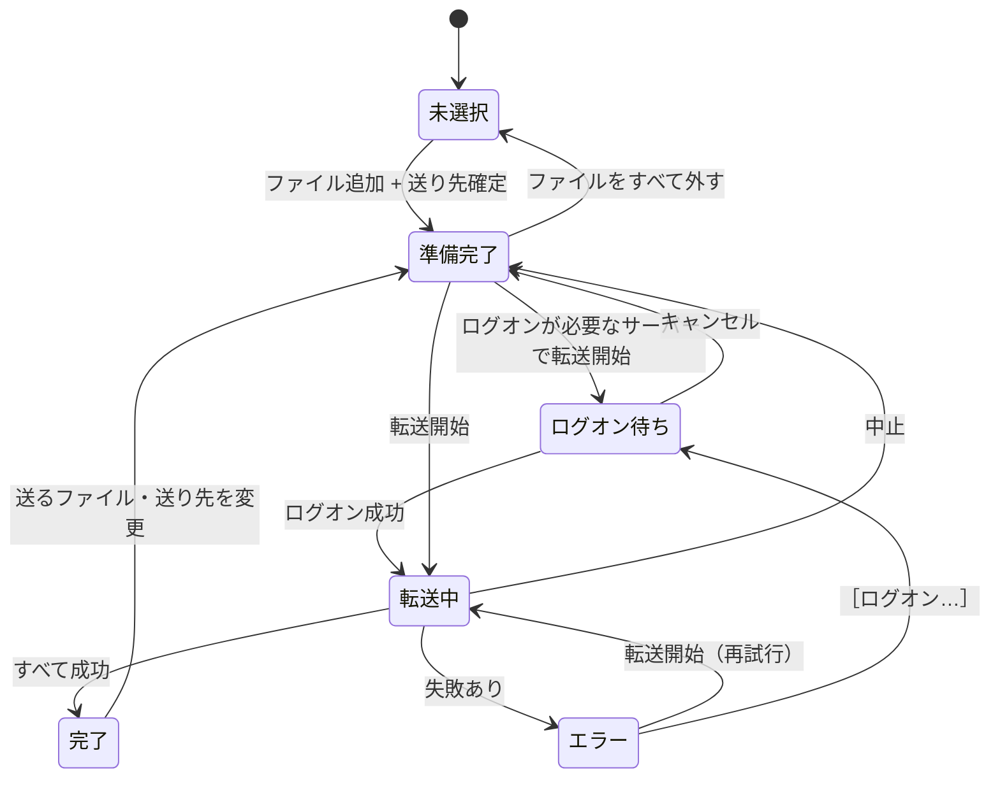
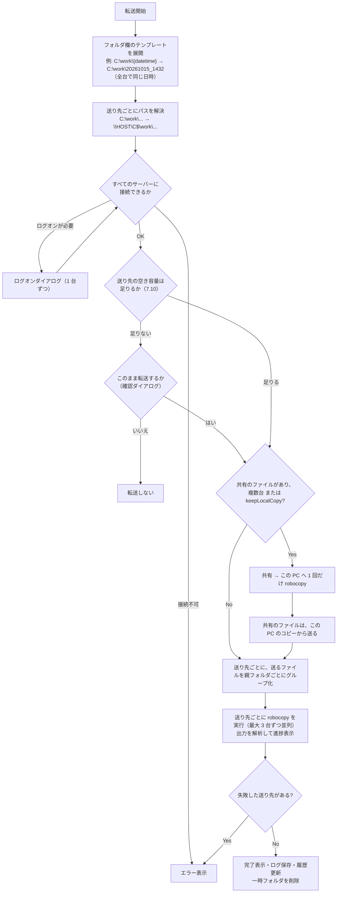
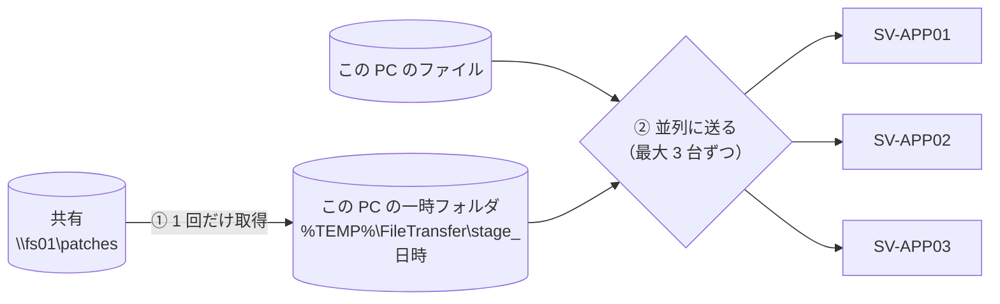
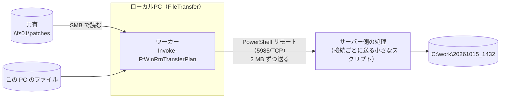
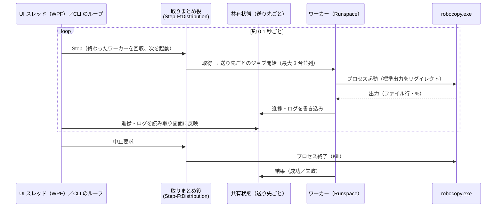

# FileTransfer 設計書（v1.3）

ファイル転送（共有フォルダ ⇔ ローカル PC ⇔ Windows Server）を、リモートデスクトップのコピー＆ペーストより速く、手軽に行うためのツールの設計書です。

- 作成日: 2026-10-15
- 状態: v1.3 実装済み（v1.1 で複数サーバーへの一括配布・コマンドライン実行、v1.2 で空き容量の確認・［切断して再試行］、v1.3 でウィンドウの横幅の変更・フォルダの選択・WinRM での転送を追加）
- UI モック: [ui-mock.html](ui-mock.html)

---

## 1. 背景と目的

### 1.1 現状の運用

```
共有フォルダ(\\fs01\patches)  ──エクスプローラーでコピペ──▶  ローカルPC
ローカルPC                    ──RDP 越しにコピペ──────────▶  Windows Server (C:\work\...)
```

### 1.2 課題

| # | 課題 | 原因 |
|---|------|------|
| 1 | RDP 越しのコピー＆ペーストが非常に遅い | RDP のクリップボード転送は RDP の仮想チャネルを通るため、通常のファイル共有（SMB）に比べて大幅に遅いことが多い |
| 2 | 共有フォルダからローカルへのコピーも遅く感じる | エクスプローラーのコピーは 1 ファイルずつ処理し、大容量ファイル向けの最適化（バッファなし I/O）も使わない |
| 3 | 共有フォルダ → サーバーへ直接置くと遅い・認証が通らない | サーバー上（RDP セッション内）から共有にアクセスすると、経路や認証（共有は AD、サーバーはローカルアカウント）が合わない |
| 4 | 手順が多い | 毎回 RDP 接続 → フォルダ作成 → コピペ、を繰り返している |

### 1.3 目的

1. RDP を使わずにファイルを配置できるようにする（SMB で直接転送）
2. 「送るファイル」と「送り先」を、最小限の操作で指定できるシンプルな GUI を提供する
3. ローカル PC・共有フォルダ・サーバーの 3 者間で、どの向きにも転送できるようにする
4. インストール不要（Python 等のランタイムを入れない）で配布できるようにする

---

## 2. 要件

### 2.1 機能要件

| ID | 要件 | 優先度 |
|----|------|--------|
| F-01 | 送るファイルを複数選択し、まとめて転送できる（ファイル／フォルダの混在も可） | 必須 |
| F-02 | 送るファイルは「ファイル選択ダイアログ」「ドラッグ＆ドロップ」「エクスプローラーでコピー → アプリに貼り付け（Ctrl+V）」で追加できる | 必須 |
| F-03 | 送り先は「このPC」（ローカルのパス、または共有フォルダの UNC パス）か「サーバーのホスト名」で指定できる | 必須 |
| F-04 | サーバーへ送るときは、サーバー上のパス（例: `C:\work`）で送り先フォルダを指定できる | 必須 |
| F-05 | 送り先フォルダ名に日付・時刻のテンプレート（例: `C:\work\{datetime}` → `C:\work\20261015_1432`）が使える | 必須 |
| F-06 | ローカルアカウント／AD アカウントのどちらでもサーバーに認証できる。資格情報は保存して次回から入力不要にできる | 必須 |
| F-07 | 転送の進捗（ファイルごと・全体）、速度、残り時間を表示し、中止できる | 必須 |
| F-08 | 送り先とフォルダは履歴から選ぶだけで指定できる | 必須 |
| F-09 | 共有フォルダ → サーバーの転送時、ローカルにもコピーを残せる（設定ファイルで指定） | 推奨 |
| F-10 | 転送完了後、送り先をエクスプローラーで開く／RDP で接続する、をワンクリックで行える | 推奨 |
| F-11 | 転送ログをファイルに残す | 推奨 |
| F-12 | 送り先にホスト名を複数書くと、同じファイルを複数のサーバーへ一括で配れる（並列。失敗したサーバーだけ再送できる） | v1.1 |
| F-13 | 画面を出さずにコマンドラインから転送できる（バッチやタスク スケジューラから呼べる。終了コードで結果がわかる） | v1.1 |
| F-14 | 転送前に送り先（と取得用のフォルダ）の空き容量を確認し、足りなければ知らせる | v1.2 |
| F-15 | サーバーに別のユーザーで接続中（エラー 1219）のとき、［切断して再試行］で今ある接続を切断して接続し直せる | v1.2 |
| F-16 | ファイル選択と同じように、フォルダもダイアログで選べる（複数可）。フォルダは中のファイルをサブフォルダごと、フォルダの構成のまま送る | v1.3 |
| F-17 | SMB（ファイル共有）で接続できないサーバーにも送れるように、設定画面でサーバーへの転送方法を WinRM（PowerShell リモート）に切り替えられる（既定は SMB） | v1.3 |
| F-18 | ウィンドウを横にも広げられる（位置と大きさを記憶する） | v1.3 |

### 2.2 非機能要件

| 項目 | 要件 |
|------|------|
| 導入 | Windows 標準機能のみで動作する。追加ランタイム（Python / Node.js / .NET の追加インストール）不要 |
| 動作環境（クライアント） | Windows 10 / 11（Windows PowerShell 5.1 と .NET Framework 4.x は OS に標準搭載） |
| 動作環境（サーバー） | Windows Server 2012 R2 以降。**サーバー側へのソフト導入は不要** |
| 性能 | RDP クリップボード転送より十分に速いこと。目安はネットワーク帯域に近い速度 |
| セキュリティ | パスワードを設定ファイルやログに平文で残さない。既存の権限以上のアクセスを可能にしない |
| 操作性 | 初めて使う人でも説明なしで使える程度に、画面項目を最小限にする |

### 2.3 スコープ外（v1 では扱わない）

- インターネット越し・ドメイン外（DMZ 等）への転送
- サーバー上でのインストーラー実行などの「配置後の作業」の自動化
- 双方向の同期（ミラーリング）、差分のみの継続同期
- 細かい転送オプション（帯域制限、属性・ACL の複製など）の GUI 設定

---

## 3. 方式検討

### 3.1 転送方式の比較

| 方式 | 速度 | 手軽さ | 必要な前提 | 評価 |
|------|------|--------|-----------|------|
| RDP クリップボード（現状） | ✕ 遅い | ○ | RDP 接続 | 現状の課題そのもの |
| RDP ドライブリダイレクト（`\\tsclient\C`） | △ | △ | RDP 接続、ドライブ共有の許可 | クリップボードよりは速いが、結局 RDP 経由 |
| SMB（`\\HOST\C$`）をエクスプローラーで操作 | ◎ | △ | 445/TCP、サーバーの管理者権限 | 速いが、認証やパス入力が毎回手間 |
| **SMB ＋ robocopy** | ◎ | ◎（GUI でラップ） | 同上 | **採用** |
| PowerShell Remoting（WinRM） | ○ | ○ | WinRM（5985/TCP）有効化 | SMB が使えないサーバー向けに、設定で切り替えて使う（v1.3。7.11） |
| 市販・フリーの転送ツール | ◎ | ○ | 導入許可・ライセンス | 導入の承認が必要になりやすい |

**採用理由**

- SMB はドメイン内の Windows 間で標準的に使えるファイル共有プロトコルで、サーバー側の追加設定・追加ソフトが基本的に不要。
- robocopy は Windows 標準のコピーコマンドで、リトライ、マルチスレッド（`/MT`）、大容量ファイル向けのバッファなし I/O（`/J`）を備え、終了コードで結果を判定できる。
- 現状 RDP でログオンしているアカウント（＝サーバーの管理者）で SMB 接続するだけなので、新たな権限付与が不要。

### 3.2 ローカル PC を「ハブ」にする構成

すべての転送をローカル PC 上のツールが仲介します。サーバー側でツールを動かしたり、サーバーから共有フォルダへアクセスさせたりはしません。


**この構成にする理由（経験上の「共有→サーバー直接は遅い／認証が通らない」への対策）**

- **認証の分離**: 共有フォルダへはログオン中の AD ユーザーで、サーバーへはサーバーごとに保存した資格情報（ローカルアカウント可）で、それぞれ別々に接続する。Windows の SMB クライアントは「接続先サーバーごと」に別の資格情報を使えるため、AD とローカルアカウントが混在していても問題にならない。
- **ダブルホップ問題の回避**: サーバー上から共有へアクセスする場合に起きる認証の受け渡し（Kerberos のダブルホップ）が発生しない。

### 3.3 共有フォルダ → サーバー の転送方法

ユーザーの想定どおり「一度ローカルを経由する」ことを基本にしつつ、ディスクに書かずに済む方法を既定にします。

| モード | 動き | 使う場面 |
|--------|------|----------|
| **中継（既定）** | robocopy で `\\fs01\...` → `\\HOST\C$\...` を直接コピー。データはローカル PC のメモリを通過するだけで、ローカルディスクには書かない | 通常時 |
| **ローカル保存あり** | ① 共有 → ローカル（`D:\Transfer\<フォルダ名>`）、② ローカル → サーバー の 2 段階 | 設定ファイルで `keepLocalCopy: true` にしたとき。画面には出さない |
| **複数台へ配る** | ① 共有 → この PC の一時フォルダ（`%TEMP%\FileTransfer\stage_<日時>`）に 1 回だけ取得、② そこから各サーバーへ並列に送る。全台に届いたら一時フォルダを消す | 送り先が 2 台以上のとき（7.8） |

中継モードでは「受信（共有→PC）」と「送信（PC→サーバー）」が同時に進むため、2 段階で行うより早く終わることが期待できます（ネットワークは送受信を同時に使えるため）。どちらが速いかは環境に依存するので、導入時に実測して既定値を決めます（[11.2 事前検証](#112-事前検証手順導入前に-5-分で確認)）。

### 3.4 GUI・配布方式の比較

| 方式 | 配布サイズ | 導入 | 開発・保守 | 評価 |
|------|-----------|------|-----------|------|
| **PowerShell ＋ WPF** | 数十 KB | 不要（OS 標準） | スクリプトなので修正しやすい。中身を誰でも確認できる | **採用** |
| C#（.NET Framework 4.8）単体 exe | 数百 KB | 不要（OS 標準） | ビルド環境（Visual Studio 等）が必要 | 有力な代替案。PowerShell が制限された環境ならこちら |
| Electron | 100 MB 以上 | exe 配布 | Node.js の開発環境が必要。中身は結局 robocopy を呼ぶだけ | この用途には過剰 |
| HTA（mshta） | 数十 KB | 不要 | 技術が古く、将来の OS で廃止のリスク | 不採用 |

**PowerShell ＋ WPF を採用**します。

- Windows 10/11 に標準搭載の Windows PowerShell 5.1 と .NET Framework で動くため、何もインストールしなくてよい。
- WPF（XAML）で、標準的な Windows アプリと同等の見た目・操作性（ドラッグ＆ドロップ、標準ファイルダイアログ等）が作れる。
- 必要に応じて `ps2exe` で exe 化もできる（[10. 配布](#10-配布インストール)）。
- 転送エンジン（robocopy）と認証処理（Win32 API）は言語に依存しない設計にしておくので、将来 C# に移植する場合も設計はそのまま使える。

---

## 4. 全体構成

### 4.1 利用イメージ

| シナリオ | 送るファイル | 送り先 | フォルダ | 操作 |
|----------|-------------|--------|---------|------|
| A. パッチをサーバーへ配置（最頻） | `\\fs01\patches\2026-10\*.msu` | `SV-APP01` | `C:\work\{datetime}` | ＋でファイルを選ぶ → 送り先を履歴から選ぶ → 転送開始 |
| B. 共有からローカルへ取得 | `\\fs01\release\app\setup.exe` | `このPC` | `D:\Transfer\{date}` | 送り先を「このPC」にして転送開始 |
| C. ローカルのファイルを共有へ | `C:\Users\...\Downloads\config.zip` | `このPC` | `\\fs01\work\yamada\{date}` | ドラッグ＆ドロップ → 転送開始 |
| D. サーバーのログをローカルへ回収 | `\\SV-APP01\C$\Logs\app.log` | `このPC` | `D:\Transfer\{date}_SV-APP01` | ファイル選択ダイアログで `\\SV-APP01\C$\Logs` を開いて選ぶ → 転送開始 |
| E. 同じパッチを複数台へ配る | `\\fs01\patches\2026-10\*.msu` | `SV-APP01, SV-APP02, SV-APP03` | `C:\work\{datetime}` | 送り先にホスト名をカンマ区切りで書く（2 回目からは履歴から選ぶ）→ 転送開始 |
| F. バッチ・タスクから配る | 同上 | 同上 | 同上 | `FileTransfer.bat -Destination SV-APP01,SV-APP02 -Folder C:\work\{datetime} \\fs01\patches\2026-10\*.msu`（7.9） |

送るファイルは「パス（ローカルパスまたは UNC パス）のリスト」として扱うため、どこにあるファイルでも同じ操作で送れます。送り先は「このPC」か「サーバーのホスト名（複数可）」の 2 種類だけで、共有フォルダは「このPC から見えるパス（`\\fs01\...`）」として扱います。

---

## 5. 画面設計

モック: [ui-mock.html](ui-mock.html)（ブラウザで開くと、画面の操作と状態遷移を確認できます）

### 5.1 メイン画面

小さめのウィンドウ 1 枚（既定 400 × 460 px 程度）で完結させます。画面にあるのは **「送るファイル」「送り先（2 つの入力欄）」「転送開始」の 3 つだけ** です。

- 縦にも横にもリサイズでき、広げるとファイル一覧が伸びる（幅は 400 px より狭くはできない）。前回の位置と大きさを記憶する。
- 接続状態・エラー・完了などのメッセージは、決まった 2 か所（送り先の下の行、ボタンの上の行）に 1 行で出す。

```
┌ FileTransfer ────────────────────── ─ ✕ ┐
│ 送るファイル  3 件・362.7 MB クリア [📁][＋] │
│ ┌────────────────────────────────────┐ │
│ │ □ KB5031234-x64.msu         312.4 MB │ │
│ │ □ setup_v2.4.1.exe           48.2 MB │ │
│ │ □ config_20261015.zip         2.1 MB │ │
│ │                                      │ │
│ └────────────────────────────────────┘ │
│ 送り先                          (WinRM) ⚙ │ ← (WinRM) は WinRM で送るときだけ
│ [● SV-APP01                          ▾] │
│ [C:\work\{datetime}                  ▾] │
│ → \\SV-APP01\C$\work\20261015_1432       │ ← 状態の行
│                                          │
│ [              転送開始              ]   │
└──────────────────────────────────────────┘
```

転送中・完了・エラーのときは、一覧の行とボタンまわりだけが変わります。

```
転送中                                  完了
│ ✓ KB5031234-x64.msu   312.4 MB │      │ ✓ 3 件を転送しました（362.7 MB・4.3 秒） 開く RDP │
│ ◌ setup_v2.4.1.exe     48.2 MB │      │ [              転送開始              ]          │
│   config_20261015.zip   2.1 MB │
│ ██████████░░░░░░░░░░░░         │      エラー
│ 62%・104.2 MB/s・残り 2 秒 [中止] │      │ ⚠ SV-WEB01：アクセスが拒否されました ログオン… 詳細 │
                                        │ [              転送開始              ]            │
```

- 転送中の行は、行の背景がそのファイルの進捗バーになる。終わった行には ✓ が付く。
- ボタンの位置は、転送中だけ全体の進捗バーと［中止］に置き換わる。

送り先にホスト名を複数書いたとき（7.8）は、次のように表示します。

```
│ [● SV-APP01, SV-APP02, SV-APP03     ▾] │
│ [C:\work\{datetime}                  ▾] │
│ → \\SV-APP01\C$\work\20261015_1432  ほか 2 台 │   ← マウスを乗せると全台のパス
...
│ 45%・1/3 台完了・98.2 MB/s・残り 6 秒 [中止] │   ← 転送中
│ ✓ 3 件を 3 台に転送しました（362.7 MB・12.3 秒） 開く RDP │   ← 完了（開く・RDP は台を選ぶメニュー）
│ ⚠ SV-APP03：アクセスが拒否されました（ほか 2 台は完了） ログオン… 詳細 │   ← 一部失敗
```

- ● はいちばん悪い状態の色になる（赤 > 確認中 > 黄 > 緑）。マウスを乗せると全台の状態が出て、クリックするとログオンするサーバーを選ぶメニューが出る。
- 一覧の行の ✓ は、全台に届いたときに付く。行の進捗バーは全台の平均。
- 一部の台だけ失敗したら、［転送開始］を押し直すと **失敗した台にだけ** 送り直す（同じ日時のフォルダへ）。

#### 画面項目

| 項目 | 内容 |
|------|------|
| ファイル一覧 | 名前とサイズだけを表示する（元の場所は、行にマウスを乗せると出る）。ドラッグ＆ドロップや、エクスプローラーでコピーしてから Ctrl+V で追加する。行の × か Delete キーで一覧から外す |
| ＋ | Windows 標準のファイル選択ダイアログ（複数選択可）を、前回開いたフォルダで開く |
| 📁（フォルダの追加） | Windows 標準のフォルダ選択ダイアログ（エクスプローラーと同じ形。複数選択可）を、前回開いたフォルダで開く。選んだフォルダは中身ごと送る（7.1） |
| クリア | 一覧を空にする（ファイルがあるときだけ表示） |
| ⚙（設定） | 設定画面（5.4）を開く。サーバーへの転送方法が WinRM のときは、左に「WinRM」と出す |
| 送り先 | ホスト名（カンマ区切りで複数可）か「このPC」を入れる。▾ で履歴から選べる（複数台の組み合わせも 1 件の履歴になる）。左端の ● が接続状態を示す（緑：接続OK／黄：ログオンが必要／赤：接続できない）。● をクリックするとログオンダイアログが開き、接続するアカウントを変えられる（複数台のときは台を選ぶメニュー） |
| フォルダ | 送り先のフォルダ。テンプレート（7.3）はこの欄にそのまま書く。▾ で履歴から選べる（「このPC」用とサーバー用で別々の履歴） |
| 状態の行 | 通常は、実際にコピーされる先のフルパスを表示する（誤った場所への配置を防ぐ）。問題があるときはその内容を表示する（「SV-DB02 へのログオンが必要です［ログオン…］」「SV-TEST99 に接続できません」「フォルダ名に使えない文字があります」など） |
| 転送開始 | 送るファイルがあり、送り先が確定しているときだけ押せる（Ctrl+Enter でも開始できる） |
| 結果の行 | 完了時は件数・サイズ・所要時間と、［開く］（エクスプローラーで送り先を開く。WinRM で送ったときはファイル共有で開けないので出さない）、［RDP］（送り先がサーバーのとき）、［送るファイルに追加］（送り先が「このPC」のとき。転送したファイルを送るファイルの一覧に入れ、転送元のファイルと入れ替える。共有から取ってきたファイルをそのままサーバーへ送れる）。エラー時は要約と、［ログオン…］［詳細］（エラーの説明とログ）。別のユーザーで接続中（エラー 1219）なら［切断して再試行］も出す |

**画面に置かないもの**

| 置かないもの | 代わりの手段 |
|--------------|-------------|
| 送り先の種類（サーバー／ローカル／共有）の切り替え | 送り先が「このPC」ならローカル、それ以外はホスト名とみなす。共有フォルダへは「このPC」で `\\fs01\...` と書く |
| サブフォルダ名の欄・テンプレートの入力補助 | フォルダ欄に直接 `{datetime}` などを書く。履歴に入っているので、2 回目からは選ぶだけ |
| 接続確認ボタン | 送り先を入力・選択したら自動で確認する |
| ログ欄 | エラー時の［詳細］から表示する。ファイルにも保存する |
| ローカルにもコピーを残す、robocopy のオプション、リトライ回数など | 設定ファイル（8 章）。設定画面（5.4）に置くのは、ユーザーが自分で切り替える必要があるものだけ |

### 5.2 ログオンダイアログ

```
┌ SV-DB02 にログオン ─────────┐
│ ユーザー名                    │
│ [SV-DB02\Administrator      ] │
│ パスワード                    │
│ [●●●●●●●●                   ] │
│ ☑ 資格情報を保存する          │
│ ☑ ログオンが必要なほかの 2 台  │ ← 複数台に送るときだけ
│   （SV-APP02、SV-APP03）にも、 │
│   同じアカウントで接続する    │
│             [キャンセル] [OK] │
└──────────────────────────────┘
```

- 開くタイミングは 3 つ。状態が「ログオンが必要」のときに［転送開始］を押したとき、状態の行の［ログオン…］を押したとき、送り先の ● をクリックしたとき。
- ユーザー名の初期値は、前回そのホストで使ったユーザー名。空欄のときは入力例（`SV-DB02\ユーザー名 または CORP\ユーザー名`）を薄く表示する。
- ［OK］で実際に接続を試み、失敗したら理由をダイアログ内に 1 行で表示する。
- ［転送開始］から開いた場合は、ログオンに成功したらそのまま転送を始める。ログオンが必要な台が複数あれば、1 台ずつダイアログを出す。
- 「ほかの n 台にも同じアカウントで接続する」にチェックすると、1 台目でログオンできたあと、残りの台にも同じパスワードで接続する。ローカルアカウント（`SV-APP01\Administrator` や `.\Administrator`）は、ホスト名の部分をそれぞれの台の名前に置き換える（`SV-APP02\Administrator`）。ドメインアカウントはそのまま使う。接続できなかった台は、結果の行に出す。
- 保存した資格情報は Windows 標準の「資格情報マネージャー」に入るため、エクスプローラーで `\\HOST\C$` を開いたときにも同じ資格情報が使われる。削除は「資格情報マネージャー」から行う（アプリに削除ボタンは置かない）。

### 5.3 状態遷移



### 5.4 設定画面

送り先の見出しの右の ⚙ で開く。置くのは、ユーザーが状況に応じて自分で切り替える必要がある項目だけにする（それ以外は設定ファイル。8 章）。

```
┌ 設定 ─────────────────────────────┐
│ サーバーへの転送方法                │
│ ◉ SMB（ファイル共有）              │
│   \\サーバー\C$ などに robocopy で… │
│ ○ WinRM（PowerShell リモート）     │
│   SMB で接続できないサーバー向け…   │
│ 「このPC」への転送には影響しません  │
│                 [キャンセル] [OK] │
└───────────────────────────────────┘
```

- 既定は SMB。WinRM を選ぶと、サーバーへの転送はすべて WinRM で行う（7.11）。
- ［OK］で `%APPDATA%\FileTransfer\settings.json` の `transfer.method` だけを書き換え（8 章）、送り先の接続を確認し直す。完了・エラーの表示は消え、次の［転送開始］は新しい転送になる。
- 転送中は開けない。

---

## 6. 処理フロー（転送開始時）



---

## 7. 機能詳細

### 7.1 送るファイルの指定

- 内部では「フルパスのリスト」として保持する（例: `\\fs01\patches\2026-10\KB5031234-x64.msu`、`C:\Users\yamada\Downloads\config.zip`）。
- 追加方法
  - **＋（ファイル選択ダイアログ）**: `Microsoft.Win32.OpenFileDialog`（`Multiselect = true`）。前回開いたフォルダから開く。共有フォルダやサーバー（`\\SV-APP01\C$\Logs` など）も、このダイアログのアドレスバーや「クイックアクセス」から開ける。
  - **📁（フォルダ選択ダイアログ）**: ファイル選択ダイアログではフォルダを選べない（ダブルクリックで中に入ってしまう）ため、別のボタンにする。Windows 標準の Common Item Dialog（`IFileOpenDialog` に `FOS_PICKFOLDERS | FOS_ALLOWMULTISELECT`。エクスプローラーと同じ見た目）を `lib\Native.cs` から開き、複数のフォルダを選べる。前回開いたフォルダから開き、次回は選んだフォルダがあるフォルダから開く。
  - **ドラッグ＆ドロップ**: `DataFormats.FileDrop`。フォルダもドロップでき、中身ごと（サブフォルダ含む）送り先にフォルダとしてコピーする。
  - **貼り付け（Ctrl+V）**: エクスプローラーで Ctrl+C したファイル・フォルダを `Clipboard.GetFileDropList()` で取得。今の「コピペ」の習慣をそのまま使える。
- 同じパスの重複追加は無視する。異なる場所にある同名ファイルは、送り先で衝突するため追加時に警告して追加しない。
- 一覧には名前とサイズだけを表示し、元のフルパスはツールチップで表示する。
- フォルダは、どの方法で追加しても同じ扱いになる。中のファイルをサブフォルダごと（空のフォルダも含めて）、フォルダの構成のまま、送り先に「フォルダ名」のフォルダとして送る（例: `C:\Build\app` → `C:\work\20261015_1432\app\...`）。ジャンクション・シンボリックリンクのフォルダは辿らない。SMB では robocopy の `/E /XJ`（7.4）、WinRM ではフォルダを辿って 1 つずつ送る（7.11）。

### 7.2 送り先の指定とパス解決

| 送り先 | フォルダ欄 | 解決後のパス |
|--------|-----------|-------------|
| `SV-APP01` | `C:\work\{datetime}` | `\\SV-APP01\C$\work\20261015_1432` |
| `SV-LEGACY01`（設定で `C:\work` ⇔ `\\SV-LEGACY01\Work$` を定義） | `C:\work\{datetime}` | `\\SV-LEGACY01\Work$\20261015_1432` |
| `このPC` | `D:\Transfer\{date}` | `D:\Transfer\20261015` |
| `このPC` | `\\fs01\work\yamada\{date}` | `\\fs01\work\yamada\20261015` |
| `SV-APP01, SV-APP02` | `C:\work\{datetime}` | `\\SV-APP01\C$\work\20261015_1432` と `\\SV-APP02\C$\work\20261015_1432` |
| `SV-APP01, SV-APP02` | `\\{host}\Deploy$\{date}` | `\\SV-APP01\Deploy$\20261015` と `\\SV-APP02\Deploy$\20261015` |

- 送り先欄はカンマ・セミコロン・読点・空白で区切って、ホスト名を複数書ける。大文字小文字を区別せず重複を除く。
- 「このPC」とサーバーは一緒に指定できない（フォルダ欄の意味が違うため）。
- 複数台のとき、送り先のパスが全台で同じになる指定（`\\fs01\work\x` など）はエラーにする（同じ場所に何度も送ることになるため）。`{host}` を含む UNC なら台ごとに別のパスになるので使える。
- 送り先が「このPC」以外なら、サーバーのホスト名とみなす。フォルダ欄は「サーバー上のパス」で書き（RDP でサーバーを触るときと同じ感覚）、`X:\path` を `\\HOST\X$\path` に変換する。UNC を直接書いた場合はそのまま使う。
- 送り先を「このPC」とサーバーで切り替えると、フォルダ欄はそれぞれで前回使った値に戻る（サーバー用の `C:\work\...` がローカルに使われる、といった取り違えを防ぐ）。
- 管理共有（`C$`）が使えないサーバー向けに、設定ファイルで「サーバーパス ⇔ 共有」のマッピングを定義できる（11.1 の対策 B）。
- 送り先フォルダが存在しなければ robocopy が自動作成する。
- 既に存在するフォルダに送る場合はそのまま追加する。
- 送り先に送るものと同じ名前のファイル・フォルダがあれば（空き容量の確認と一緒に調べる）、転送の前に確認ダイアログで［上書き］［名前を変えて送る］［キャンセル］を選ぶ。
  - ［上書き］: robocopy の既定動作（内容が同じならスキップ、異なれば上書き）。フォルダは中のファイルを上書きする。
  - ［名前を変えて送る］: どの送り先にもない名前に連番を付ける（`setup (2).exe`、`logs (2)`）。robocopy は名前を変えてコピーできないので、ファイルは送り先の作業用フォルダ（`~FileTransfer_xxxxxxxx`）にコピーしてから新しい名前で移す。フォルダは新しい名前のフォルダへコピーする。
  - エラー後のやり直しでは聞き直さず、最初に選んだとおりにする。コマンドラインでは聞かずに上書きする。

### 7.3 フォルダ名テンプレート

フォルダ欄に直接書きます（例: `C:\work\{datetime}`）。

| テンプレート | 展開例（2026-10-15 14:32:10 開始） | 備考 |
|-------------|-------------------------------------|------|
| `{datetime}` | `20261015_1432` | |
| `{date}` | `20261015` | 既定 |
| `{time}` | `1432` | |
| `{now:書式}` | `{now:yyyy-MM-dd_HHmmss}` → `2026-10-15_143210` | .NET の日時書式を自由に指定 |
| `{user}` | `yamada` | Windows のログオンユーザー名 |
| `{host}` | `SV-APP01` | 送り先ホスト名（サーバー時。複数台のときは台ごとに展開） |

- 固定文字列と組み合わせ可能（例: `C:\work\{date}_KB5031234` → `C:\work\20261015_KB5031234`）。
- 階層の途中にも書ける（例: `C:\work\{date}\patch`）。
- 日時は **転送開始時刻** で確定する（状態の行は現在時刻で表示）。複数台に送るときも全台で同じ日時になる。
- ファイル名に使えない文字（`: * ? " < > |`）が含まれる場合は、フォルダ欄の文字を赤くし、状態の行に理由を出して転送開始を押せなくする（`/` は `\` として扱う）。
- 送り先が「このPC」のときは、`%USERPROFILE%` などの環境変数も展開する（サーバーのパスでは展開しない）。

### 7.4 転送エンジン（robocopy）

#### 実行単位

robocopy は「1 つのコピー元フォルダ → 1 つのコピー先フォルダ」単位で動くため、送るファイルを **親フォルダごとにグループ化** して、グループごとに 1 回実行する。

```powershell
# ファイル（同じ親フォルダのものをまとめて 1 回で）
robocopy '\\fs01\patches\2026-10' '\\SV-APP01\C$\work\20261015_1432' 'KB5031234-x64.msu' 'KB5031235-x64.msu' <共通オプション>

# フォルダ（フォルダ名を送り先に付けて /E）
robocopy 'C:\Build\app' '\\SV-APP01\C$\work\20261015_1432\app' /E /MT:8 <共通オプション>
```

- ファイル名の引数が多くコマンドラインの長さ上限に近づく場合は、複数回に分割する。
- 1 つの送り先の中では、グループを順番に実行する。複数の送り先へは並列に実行する（7.8）。

#### 共通オプション（既定値・設定ファイルで変更可）

| オプション | 目的 |
|-----------|------|
| `/R:2 /W:3` | 失敗時のリトライ 2 回、待機 3 秒（既定の 100 万回・30 秒では固まって見えるため） |
| `/J` | バッファなし I/O。大容量ファイル（既定: 256 MB 以上）を含むグループにだけ付ける |
| `/MT:8` | マルチスレッド。**フォルダ転送（多数ファイル）時のみ**付ける（`/MT` 使用時はファイルごとの % 表示が出ないため、ファイル転送では付けない） |
| `/BYTES /FP /NDL /NJH /NJS` | 進捗解析しやすい出力にする（サイズをバイトで、フルパスで、フォルダ行・ヘッダ・集計なし） |
| `/XJ` | ジャンクションを辿らない（フォルダ転送時の無限ループ防止） |
| `/XX` | 送り先にだけあるファイルを一覧に出さない（コピー対象と誤認しないため。削除もしない） |

#### 進捗の取得

- robocopy の標準出力を読み、「ファイル行（`\t    New File  \t\t<バイト数>\t<フルパス>`）」と「`nn.n%` の進捗」を正規表現で解析する。
- 進捗は改行ではなく CR（`\r`）で上書き出力されるため、`\r` と `\n` の両方を区切りとして読む。
- 出力の文字コード: robocopy は出力をリダイレクトされると、システムの OEM コードページで書く（`/UNICODE` を付けてもパイプには効かないことを実機で確認）。そのため `GetOEMCP()` で得たコードページで読む（日本語環境なら通常 932、「UTF-8 を使用」設定なら 65001）。
- エラー行は表示言語によらず `<番号> (0x<16進>)` の書式なので、この部分から Win32 エラーコードを取り出す。
- 全体進捗 ＝（終わったステップのバイト数 ＋ 今のステップで終わったファイル ＋ 今のファイルのサイズ × %）÷ 合計バイト。送り先と同じ内容でスキップされたファイルは一覧に出ないため、ステップの終わりでまとめて加算する。
- 速度は直近 4 秒の平均、残り時間は（残りバイト ÷ 速度）。
- ログは robocopy の出力をアプリが読み取って、自前のログ（7.7）に書く。

#### 届いたかの確認

robocopy は、存在しないファイル名を指定されてもエラーにしない（終了コード 0〜1 のまま）。そのため、ファイル転送のステップが終わったら、指定したファイルが送り先にあるかを確認し、ないものがあればエラー（「一部のファイルが送り先に届いていません」）にする。

#### 終了コードの判定

| 終了コード | 意味 | 扱い |
|-----------|------|------|
| 0 | コピー対象なし（すべて同一） | 成功（「同一のためスキップ」と表示） |
| 1 | コピー成功 | 成功 |
| 2, 3 | 送り先に余分なファイルあり（＋コピー成功） | 成功 |
| 4〜7 | 不一致あり | 成功（警告をログに記録） |
| 8 以上 | 一部またはすべて失敗 | エラー |

### 7.5 認証処理

#### 接続確認（送り先の入力時・転送開始時）

接続確認のボタンは置かず、送り先の入力が止まってから 0.7 秒後（履歴から選んだときはすぐ）に自動で確認する。

1. `445/TCP` に 2 秒のタイムアウトで TCP 接続を試みる（到達不能なホストで画面が固まらないように）。
2. 送り先の共有（`\\HOST\C$`）にアクセスできるか確認する。
3. 結果を送り先の ● と状態の行に反映する。

複数台のときは、台ごとにバックグラウンドで並列に確認する。状態の行には、いちばん対応が必要なもの（接続できない → 共有がない → ログオンが必要 → 確認エラー の順）を「SV-APP03 ほか 1 台へのログオンが必要です」のようにまとめて出し、全台の状態はツールチップに出す。

| 結果 | ● | 状態の行 |
|------|---|---------|
| アクセス可 | 緑（ツールチップに接続ユーザー名） | `→ \\SV-APP01\C$\work\20261015_1432` |
| アクセス拒否・ログオン失敗 | 黄 | `SV-DB02 へのログオンが必要です［ログオン…］` |
| 445/TCP に到達不可 | 赤 | `SV-TEST99 に接続できません［再試行］［有効化スクリプトをコピー］` |
| 管理共有が見つからない | 赤 | `\\SV-TEST99\C$ が見つかりません（管理共有が無効の可能性があります）［再試行］［有効化スクリプトをコピー］` |

［有効化スクリプトをコピー］は SMB のときだけ出す。`tools\EnableSMB.bat` をファイルとしてクリップボードに置き（`Clipboard.SetFileDropList`）、「コピーしました。RDP 先で貼り付けて実行してください」と知らせる。サーバーに RDP で接続して Ctrl+V で貼り付け、ダブルクリックすると、管理者に昇格して Server サービス・管理共有・SMB2/3・ファイアウォール（ファイルとプリンターの共有）・LocalAccountTokenFilterPolicy を有効にする（元の値は `HKLM\SOFTWARE\FileTransfer\EnableSMB` に記録し、`tools\DisableSMB.bat` で戻せる）。［再試行］は接続を確認し直す（サーバーでスクリプトを実行したあとに押すと、つながれば転送できるようになる）。

#### 資格情報の使い方

| 資格情報 | 方法 |
|---------|------|
| ログオン中の AD ユーザー | 何もしない（Windows が自動で Kerberos 認証）。共有フォルダ、および AD ユーザーが管理者になっているサーバー |
| 保存する（既定） | Win32 API `CredWrite` で「Windows 資格情報」（種類: ドメインパスワード、ターゲット: ホスト名）に保存。以後、SMB クライアントが自動で使う。パスワードは Windows が DPAPI で暗号化してユーザーごとに保管する |
| 保存しない | Win32 API `WNetAddConnection2` で今回だけ接続し、アプリ終了時に `WNetCancelConnection2` で切断 |

- `cmdkey` / `net use` コマンドでも同じことができるが、パスワードがコマンドラインに載る（プロセス一覧から見える）ため、API を P/Invoke で呼ぶ。
- 資格情報のターゲット名は入力したホスト名そのもの（大文字に正規化）。短い名前と FQDN は別扱いになる点に注意。
- 1 台のサーバーに対して、同時に 2 つの異なるユーザーでは接続できない（Windows の仕様。エラー 1219）。ログオン時にこのエラーになったら、まずこのアプリが以前に張った接続を切って再試行し、それでもだめなら同じサーバーの別名（FQDN、IP アドレス）で接続し直す（SMB は名前ごとに別の接続として扱うため）。別名で接続したときは、以後そのサーバーへのパスに別名を使う。それでもだめなときは、ダイアログに［切断して再試行］を出す（7.10）。
- 複数台のログオンは `Connect-FtShareGroup` が行う。1 台目に接続できたら、残りの台にユーザー名を置き換えて（5.2）同じパスワードで接続する。

### 7.6 エラー処理

転送中のエラーは、ボタンの上の結果の行に要約を 1 行で出し（例: `SV-WEB01：アクセスが拒否されました`）、下表の説明とログは［詳細］で表示する。

| 状況 | 代表的なエラーコード | ［詳細］の説明（案） |
|------|----------------------|----------------------|
| ホストが見つからない／到達できない | 53, 445 接続タイムアウト | 「SV-APP01 に接続できません。ホスト名と、ファイル共有（445番ポート）が許可されているか確認してください。」 |
| ユーザー名・パスワード誤り | 1326, 86 | 「ユーザー名またはパスワードが正しくありません。」 |
| アクセス拒否 | 5 | 「アクセスが拒否されました。管理者権限のあるアカウントか確認してください。ローカルアカウントの場合、組み込みの Administrator 以外は管理共有（C$）に接続できないことがあります（→ 管理者向け手順 11.1）。」 |
| 別の資格情報で接続済み | 1219 | 「このサーバーには、別のユーザーで接続中です。［切断して再試行］で、この PC からそのサーバーへの接続（ネットワーク ドライブなど）を切断して接続し直せます。…」［切断して再試行］ボタン（7.10） |
| 共有が存在しない | 67 | 「\\SV-APP01\C$ が見つかりません。管理共有が無効になっている可能性があります。」 |
| アカウントのロック・無効 | 1909, 1331 | 「アカウントがロックされているか無効です。」 |
| 送り先の容量不足 | 112 | 「送り先のディスク容量が不足しています。」 |
| ファイル使用中 | 32 | 「ファイルが使用中のためコピーできません: <ファイル名>」 |

- 転送前に送り先の空き容量を確認し、足りなければ知らせる（7.10）。確認できなかった場合や、確認後に容量が減った場合は、robocopy がエラー 112 で止まり、「ディスクの空き容量が足りません」と表示する。
- 再試行用のボタンは置かない。エラーの表示中に［転送開始］を押し直すと、次のように送り直す。
  - 送り先フォルダの `{datetime}` は展開し直さず、前回と同じフォルダへ送る（時刻が変わって別フォルダになるのを防ぐ）。
  - 複数台のときは、**失敗した台にだけ** 送る。この PC に取得済みのコピーがあれば、それを使う（共有から読み直さない）。
  - 送り先に同じ内容で届いているファイルは robocopy がスキップするため、実質的に失敗した分だけが送られる。
- 送るファイル・送り先・フォルダを変えると、エラーの表示は消え、次の［転送開始］は新しい転送になる。
- 複数台のうち一部だけ失敗したときは、結果の行に「SV-APP03：アクセスが拒否されました（ほか 2 台は完了）」（2 台以上失敗なら「2 台で失敗しました（1 台は完了）」）と出し、［詳細］に台ごとの結果を一覧で出す。
- ［中止］時は robocopy プロセスを終了する。途中まで書かれたファイルは robocopy の仕様上残るため、中止後に「途中のファイルが残っている可能性があります」と表示し、該当ファイル名をログに出す。

### 7.7 ログと履歴

- ログ: `%LOCALAPPDATA%\FileTransfer\logs\yyyyMMdd.log` に 1 日 1 ファイルで追記。転送ごとに「開始時刻・ユーザー・送るファイル・送り先・結果・所要時間・平均速度」と robocopy の出力を記録。保存期間は 30 日（設定可）。
- 履歴（設定ファイルに保存）: 送り先（ホスト名）、フォルダ（「このPC」用とサーバー用で別々）を、それぞれ最近使った順に最大 10 件。複数台の組み合わせ（`SV-APP01, SV-APP02`）は 1 件の履歴として残るので、よく使う配布先のセットを選ぶだけで呼び出せる。ファイル選択ダイアログで最後に開いたフォルダも記憶する。
- 次回起動時は、前回の送り先・フォルダを復元する（送るファイルは復元しない）。
- 複数台・取得ありのときは、ログの各行の先頭に `[SV-APP01]` `[この PC へ取得]` のように対象を付ける。
- コマンドラインから実行した転送も、同じログファイルに書く。

### 7.8 複数サーバーへの一括配布

送り先欄にホスト名を複数書くと（`SV-APP01, SV-APP02, SV-APP03`）、同じファイルを各サーバーに配る。画面とコマンドラインで同じ仕組み（`lib\Distribution.psm1`）を使う。



| 項目 | 内容 |
|------|------|
| 取得 | 送るファイルに共有（UNC）のものがあれば、まずこの PC の一時フォルダに 1 回だけ取得し、各サーバーへはそこから送る（共有を台数分読まない）。この PC にあるファイルはそのまま送る。1 台だけのときは取得せず中継する（3.3） |
| 一時フォルダ | `%TEMP%\FileTransfer\stage_<日時>`。全台に届いたら消す。一部失敗したときは再送に使うため残し、エラーの表示を抜けたとき（送り先などを変えたとき）やアプリを閉じたときに消す。`keepLocalCopy` が有効なら、一時フォルダの代わりに `localCopyFolder` に取得して残す |
| 並列数 | 設定 `transfer.parallelHosts`（既定 3）。台ごとに Runspace で robocopy を実行する |
| 取得に失敗したとき | どのサーバーにも送らない（結果の行に「この PC への取得に失敗しました：…」） |
| 中止 | 実行中の robocopy をすべて止め、まだ始めていない台は送らない |
| 進捗 | 全体のバー ＝（取得のバイト数 ＋ 各台のバイト数）の合計に対する割合。行のバーは全台の平均で、全台に届いた行に ✓ を付ける |
| 結果 | 全台成功・一部成功・全台失敗・中止 を区別して表示する（5.1、7.6）。［開く］［RDP］は台を選ぶメニューになる |

### 7.9 コマンドライン実行

`FileTransfer.ps1`（または `FileTransfer.bat`）に引数を付けると、画面を出さずに転送する。バッチファイルやタスク スケジューラから呼べる。

```bat
FileTransfer.bat -Destination SV-APP01,SV-APP02 -Folder C:\work\{datetime} \\fs01\patches\2026-10\*.msu
FileTransfer.bat -Destination このPC -Folder D:\Transfer\{date} \\fs01\release\app\setup.exe
```

| 引数 | 内容 |
|------|------|
| `-Destination`（`-To`） | 送り先。ホスト名（カンマ区切りで複数可）または `このPC` |
| `-Folder` | 送り先のフォルダ。画面のフォルダ欄と同じ書き方（テンプレート可） |
| 送るファイル（`-Source` または末尾に並べる） | ファイル・フォルダのパス。`*` `?` を使える。スペースを含むときは `"` で囲む |
| `-Credential <ユーザー名>` | ログオンが必要なサーバーに、このアカウントで接続する（パスワードは起動時に聞かれる）。複数台では 5.2 と同じくユーザー名を置き換える |
| `-SaveCredential` | `-Credential` のアカウントを資格情報マネージャーに保存する |
| `-KeepLocalCopy` | 共有のファイルを、この PC にもコピーして残す |
| `-DisconnectExisting` | 別のユーザーで接続中（エラー 1219）のサーバーは、その接続を切断してからログオンし直す（画面の［切断して再試行］と同じ） |
| `-SkipSpaceCheck` | 送り先の空き容量が足りなくても転送する |
| `-Method SMB\|WinRM` | サーバーへの転送方法（7.11）。省略すると設定（設定画面・`settings.default.json`）の方法。WinRM では、`-Credential` のアカウント → 保存済みの資格情報 → Windows のログオンユーザー の順で接続する |
| `-WhatIf` | 送り先・空き容量と、実行する robocopy のコマンドを表示するだけで転送しない（ログオンも切断もしない。WinRM では接続できるかの確認はする）。接続できない台や空き容量の不足があれば、それも表示する |

| 終了コード | 意味 |
|-----------|------|
| 0 | すべて成功（`-WhatIf` で問題がないときも 0） |
| 1 | 転送に失敗した（一部の送り先だけ失敗した場合も含む） |
| 2 | 指定の誤り、送るファイルが見つからない、接続できない・ログオンが必要なサーバーがある、空き容量が足りない（`-SkipSpaceCheck` なし）（転送は始めない） |

- 転送を始める前に、すべての送り先の接続と空き容量を確認する。1 台でも問題があれば、どこにも送らずに終了コード 2 で終わる（バッチで部分的に配られた状態を作らないため）。
- エラー 1219 で接続できなかったときは、そのサーバーへの今ある接続を一覧で表示し、`-DisconnectExisting` を案内する。
- 資格情報は、画面で保存したもの（資格情報マネージャー）がそのまま使われる。毎回 `-Credential` を書く必要はない。
- 進行状況はコンソールに表示し（台ごとの完了・失敗と robocopy の出力）、画面からの転送と同じログファイルにも書く。
- Ctrl+C で止めると、実行中の robocopy も止め、一時フォルダを消す。
- 引数の解釈は PowerShell が行う。`powershell.exe -File FileTransfer.ps1 ...` で直接呼んでもよい。

### 7.10 空き容量の確認と［切断して再試行］

#### 転送前の空き容量の確認

［転送開始］を押すと、まず空き容量を確認してから転送を始める（確認はサーバーに問い合わせるため裏で行い、その間は「空き容量を確認しています…」と表示して［中止］できる）。

| 確認する場所 | 必要な容量 |
|--------------|-----------|
| 各送り先 | 送るファイルの合計サイズ。ただし送り先に同じ名前・同じサイズのファイルが既にあれば数えない（やり直しのとき、届いている分で警告しないため） |
| この PC の取得用フォルダ（複数台・`keepLocalCopy` のとき） | 共有（UNC）にあるファイルの合計サイズ。やり直しで取得済みのコピーを使うときは確認しない |

- 空き容量は Win32 API `GetDiskFreeSpaceEx`（そのユーザーが使える空き容量。クォータも反映される）で、送り先のパスのうち実在するいちばん近いフォルダについて調べる（送り先フォルダはまだないことが多いため）。
- 足りない場所があれば、「次の送り先の空き容量が足りません。SV-APP02（\\SV-APP02\C$）：空き 1.20 GB ／ 必要 3.50 GB …… このまま転送しますか？」と確認する。［いいえ］なら転送せず、結果の行に「空き容量が足りないため、転送をやめました」と出す。［はい］なら転送し、そのことをログに残す。
- 確認できなかった場所（権限がないなど）は、警告せずに転送する（ログには残す）。
- コマンドラインでは、足りなければ転送せずに終了コード 2 で終わる。`-SkipSpaceCheck` を付けると、足りなくても転送する。

#### ［切断して再試行］（エラー 1219）

Windows は、1 台のサーバーに対して、同時に 2 つの異なるユーザーで接続できない。エクスプローラーのネットワーク ドライブなどで別のユーザーで接続していると、ログオンがエラー 1219 になる。

| 出る場所 | 押したときの動き |
|----------|-----------------|
| ログオンダイアログ（ログオンが 1219 になったとき。今ある接続の一覧も出す） | そのサーバーへの接続を切断してから、入力済みのアカウントでもう一度ログオンする |
| 状態の行（接続確認の結果が「別のユーザーで接続中」のとき） | 切断して、接続を確認し直す |
| 結果の行（転送が 1219 で失敗したとき） | 切断して、接続を確認し直し、確認が済んだら送り直す（ログオンが必要なら、ログオンダイアログが出る） |

- 切断するのは、この PC のユーザーが張っている「net use」の接続のうち、そのサーバー（ホスト名・FQDN・IP アドレス）宛てのもの。`WNetOpenEnum` / `WNetEnumResource` で一覧を取り、`WNetCancelConnection2` で切断する。
- 使用中のファイルがある接続は無理に切らない（force = false）。切れなかったものは「使用中のため切断できない接続があります」と表示する。
- ネットワーク ドライブの登録自体は消さない（次回ログオン時にはまた接続される）。今のセッションの接続だけを切る。
- 切断できる接続が見つからないこともある（エクスプローラーでサーバーを開いただけの、一覧に出ない接続など）。そのときは送り直さず、「切断できる接続はありませんでした。エクスプローラーで開いているウィンドウを閉じて、数分待ってから再試行してください」と表示する。
- コマンドラインでは `-DisconnectExisting` を付けると、1219 のときに同じことをしてからログオンし直す。

### 7.11 WinRM での転送（SMB で接続できないサーバー向け）

サーバーでファイル共有（SMB）が無効、445/TCP がファイアウォールで閉じている、などで SMB で接続できないサーバーには、PowerShell リモート（WinRM）で送る。設定画面（5.4）で切り替える（既定は SMB）。コマンドラインでは `-Method WinRM`。処理は `lib\WinRm.psm1`。



| 項目 | 内容 |
|------|------|
| 送り先のパス | フォルダ欄のサーバー上のパス（`C:\work\{datetime}`）をそのまま使う（`\\HOST\C$` には変換しない）。UNC（`\\…`）は「WinRM で送るときは、フォルダをサーバー上のパス（C:\work など）で入力してください」としてエラーにする。`serverShareMappings` と別名（7.5）は使わない。複数台のとき、全台が同じパスになってよい |
| 接続 | `New-PSSession`（`winrm.useSsl` / `winrm.port` を反映）。接続できたら、サーバー側で動かす小さなスクリプト（受け取ったデータをファイルに書く・フォルダを作る・空き容量を返す など）を 1 回送っておき、以後はコマンド名と引数だけを送って呼ぶ。サーバー側のスクリプトは PowerShell 3.0 の書き方だけを使う（Windows Server 2012 R2 の 4.0 でも動く）。サーバーにソフトは入れない |
| 送り方 | 大きいファイルは 2 MB（`winrm.chunkSizeMB`）ずつ読んでは送る（open → write × n → close）。2 MB 以下のファイルは、まとめて 1 回で送る（最大 200 個・2 MB まで。小さいファイルが多いフォルダで往復を減らすため）。`Copy-Item -ToSession` は進捗と中止を細かく扱えないので使わない |
| フォルダ | この PC 側でフォルダを辿り（ジャンクションは辿らない）、送り先にフォルダの構成のまま作る。空のフォルダも作る。読めないサブフォルダがあれば、残りを送ってから失敗として知らせる（robocopy と同じ） |
| 同じファイルの省略 | 送る前に、送り先に同じファイル（サイズと更新日時が同じ）があるかをまとめて問い合わせ、あれば送らない。書き終えたファイルの更新日時はコピー元に合わせる。これで、やり直しのとき届いている分を送り直さない（robocopy と同じ） |
| 書きかけのファイル | `名前.ftpart` に書き、書き終わってから本来の名前にする（同じ名前のファイルがあれば置き換える）。中止・失敗したら `.ftpart` を消すので、途中までのファイルが残らない（接続そのものが切れたときは残ることがあるが、次の転送で上書きされる） |
| 進捗・中止 | 送るたびに共有状態（Sync）に進捗を書く（robocopy と同じ形。7.4）。［中止］は次に送る前に止め、書きかけのファイルを消す |
| 空き容量 | サーバー側で、送り先のパスのうち実在するいちばん近いフォルダのドライブの空き容量（`DriveInfo.AvailableFreeSpace`。クォータも反映）を調べる。同じ名前・同じサイズのファイルが既にあれば数えない（7.10） |
| 接続確認 | 送り先の入力時に、WinRM のポート（5985、HTTPS なら 5986）への TCP 接続（2 秒）→ 実際に接続してサーバー側のユーザー名を取得、まで行う。結果は ● と状態の行に出す（SMB と同じ。共有が見つからない・別のユーザーで接続中、はない） |
| 資格情報 | ログオンダイアログは SMB と同じ。接続を確かめてから、このセッションの間は資格情報を覚えておき、転送のたびにその資格情報で接続する（SMB と違い、接続が残らないため）。「資格情報を保存する」なら、資格情報マネージャーの汎用資格情報（`FileTransfer:WinRM:ホスト名`）に保存する。SMB 用の「Windows 資格情報」はパスワードを読み出せないため、WinRM には使えない。資格情報がなければ Windows のログオンユーザーで接続する（ドメイン環境の Kerberos） |
| 結果の行 | ［開く］は出さない（ファイル共有で開けないため）。［RDP］は出す |
| 共有のファイル | 共有フォルダ（UNC）のファイルは、この PC から SMB で読んで送る（サーバーから共有を読ませない。3.2 と同じ）。複数台に配るときは、SMB と同じく先にこの PC へ 1 回だけ取得する（7.8） |

エラーは次のように扱う（`ConvertFrom-FtWinRmError`）。

| 状況 | 判定 | 画面 |
|------|------|------|
| アクセス拒否・ログオン失敗（`AccessDenied`、エラー 5・1326 など） | ログオンが必要 | 黄の ●、［ログオン…］ |
| WinRM に接続できない（5985 に届かない、`0x80338012` など） | 接続できない | 「SV-APP01 に接続できません（ホスト名と、サーバーで WinRM（5985 番ポート）が有効か確認してください）」 |
| TrustedHosts に登録されていない（`0x803380E4`。ドメイン外のサーバーや IP アドレスで接続したとき） | エラー | 「この PC の WinRM の TrustedHosts に登録されていないため、接続できません」。［詳細］に、TrustedHosts への登録（管理者の PowerShell で `Set-Item WSMan:\localhost\Client\TrustedHosts`）か HTTPS（`winrm.useSsl`）が必要なことを出す。この PC の設定は変えない |
| 書き込みの失敗（サーバー側） | サーバー側で Win32 のエラーコードにして返す（5 アクセス拒否、112 容量不足 など） | SMB と同じ文言（7.6）。ただし管理共有・445 番ポートの説明は WinRM 向けにする |

- テスト用に、環境変数 `FILETRANSFER_TEST_WINRM_LOCAL` を設定すると、サーバーの代わりにこの PC に別の PowerShell を起動して（`CreateOutOfProcessRunspace`）同じ処理を動かす。値の受け渡しはリモートと同じくシリアル化されるので、WinRM を有効にしていない PC でも、転送・中止・空き容量・画面とコマンドラインの流れを確かめられる（`tests\Run-Tests.ps1`、`tests\Render-Screens.ps1`）。実際のサーバーへの接続（`New-PSSession`）とエラーの判定は、実機で確かめる必要がある。

---

## 8. 設定ファイル

設定は次の順に重ねて読む（後のものが優先）。パスワードはどこにも含めない。

1. アプリに組み込みの既定値
2. 配布フォルダの `settings.default.json`（部署で使うサーバーの一覧、`serverShareMappings`、転送オプションなどを管理者が配る）
3. `%APPDATA%\FileTransfer\settings.json`（ユーザーごと）

アプリがユーザーの `settings.json` に書くのは `history`・`last`・`window` と、設定画面（5.4）で変えた項目（`transfer.method`）だけ。設定画面で変えた項目は、その 1 項目だけを書く（`transfer` のほかの項目は書かない）。転送オプションなどは書かないので、管理者が `settings.default.json` を更新すれば全員に反映される。ユーザーが自分で `settings.json` に書いた項目は、アプリが保存しても消えずに残る。

`transfer.method` は、管理者が `settings.default.json` で既定を変えることもできる（例: SMB が使えないサーバーばかりの部署なら `"winrm"`）。ユーザーが設定画面で一度変えると、そのユーザーではその値が優先される。

`history` は初回だけ `settings.default.json` の値を使い、一度保存した後はユーザーの履歴が優先される（後から配布側に追加したサーバーは、既存ユーザーの履歴には自動では入らない）。

全項目の例:

```json
{
  "version": 1,
  "history": {
    "destinations": ["SV-APP01", "SV-WEB01", "SV-DB02"],
    "serverFolders": ["C:\\work\\{datetime}", "C:\\work\\{date}", "D:\\Deploy\\{datetime}"],
    "localFolders": ["D:\\Transfer\\{datetime}", "\\\\fs01\\work\\yamada\\{date}"],
    "lastOpenDir": "\\\\fs01\\patches\\2026-10"
  },
  "last": {
    "destination": "SV-APP01",
    "folder": "C:\\work\\{date}",
    "items": ["\\\\fs01\\patches\\2026-10\\KB5031234.msu"]
  },
  "window": { "left": 200, "top": 160, "width": 400, "height": 460 },
  "serverShareMappings": [
    { "host": "SV-LEGACY01", "serverPath": "C:\\work", "share": "\\\\SV-LEGACY01\\Work$" }
  ],
  "transfer": {
    "method": "smb",
    "retryCount": 2,
    "retryWaitSec": 3,
    "unbufferedThresholdMB": 256,
    "threadsForFolders": 8,
    "parallelHosts": 3,
    "keepLocalCopy": false,
    "localCopyFolder": "D:\\Transfer\\{datetime}"
  },
  "winrm": {
    "useSsl": false,
    "port": 0,
    "chunkSizeMB": 2
  },
  "log": {
    "retentionDays": 30
  }
}
```

| 項目 | 内容 |
|------|------|
| `transfer.method` | サーバーへの転送方法。`smb`（既定）か `winrm`（7.11）。設定画面で切り替える |
| `winrm.useSsl` | WinRM を HTTPS（既定 5986）で接続する |
| `winrm.port` | WinRM のポート。0 なら既定（HTTP 5985 / HTTPS 5986） |
| `winrm.chunkSizeMB` | WinRM で 1 回に送る大きさ（MB。既定 2、最大 4。サーバーが 1 回に受け取れる大きさ（既定 10 MB）に収めるため）。これ以下のファイルはまとめて送る |

---

## 9. 内部構成

### 9.1 ファイル構成

```
FileTransfer/
├─ FileTransfer.ps1            … エントリポイント。画面の生成とイベント処理
├─ FileTransfer.bat            … 開発・確認用の起動バッチ（配布先では FileTransfer.exe を使う）
├─ FileTransfer.ico            … アイコン（tools\New-Icon.ps1 で生成）
├─ install.bat                 … インストール／更新（-Uninstall で削除）
├─ settings.default.json       … 配布時の既定設定（サーバーの一覧等）
├─ ui/
│   ├─ Styles.xaml             … 色・ボタンなどの共通スタイル
│   ├─ MainWindow.xaml         … メイン画面
│   ├─ LogonDialog.xaml        … ログオンダイアログ
│   ├─ SettingsDialog.xaml     … 設定（サーバーへの転送方法）
│   └─ DetailsDialog.xaml      … エラーの［詳細］
├─ lib/
│   ├─ Config.psm1             … 設定・履歴の読み書き
│   ├─ PathResolver.psm1       … テンプレート展開、サーバーパス→UNC 変換、入力チェック
│   ├─ Connection.psm1         … 接続確認、ログオン（資格情報の保存・接続・切断）
│   ├─ TransferEngine.psm1     … 実行計画の作成、robocopy 実行、出力解析、エラー文言
│   ├─ WinRm.psm1              … WinRM での接続確認・ログオン・空き容量・転送（7.11）
│   ├─ Distribution.psm1       … 取得と、送り先ごとの並列実行の取りまとめ（画面・コマンドライン共通）
│   ├─ Cli.psm1                … コマンドライン実行
│   ├─ Log.psm1                … ログ出力・古いログの削除
│   ├─ Native.cs               … P/Invoke（GetFileAttributes / WNetAddConnection2 / CredWrite / CredRead など）と、フォルダ選択ダイアログ（IFileOpenDialog）
│   └─ Models.cs               … ファイル一覧の行（FileItem、変更通知つき）
├─ launcher/Launcher.cs        … FileTransfer.exe のソース（コンソールを出さずに起動する）
├─ tools/
│   ├─ Install.ps1             … install.bat の本体
│   ├─ Build-Launcher.ps1      … csc.exe で FileTransfer.exe をビルド
│   └─ New-Icon.ps1            … FileTransfer.ico を作り直す
├─ tests/
│   ├─ Run-Tests.ps1           … 自動テスト（パス解決・計画・出力解析・実際の転送・複数台・中止・コマンドライン）
│   └─ Render-Screens.ps1      … 画面を画面外に出して操作し、各状態を PNG に保存する結合テスト
└─ docs/                       … 設計書・UI モック
```

- `lib\*.cs` は起動時に `Add-Type` でコンパイルする。毎回のコンパイルは 1 秒ほどかかるため、ソースのハッシュごとに `%LOCALAPPDATA%\FileTransfer\bin` に DLL をキャッシュする。
- `.ps1` / `.psm1` は BOM 付き UTF-8 で保存する（Windows PowerShell 5.1 は BOM なしの UTF-8 を Shift-JIS として読むため）。`.cs` と `.bat` は ASCII のみにする。

### 9.2 スレッド構成

WPF の画面は UI スレッドで動かし、転送や接続確認は別スレッド（PowerShell の Runspace）で実行して画面が固まらないようにする。

転送は「取りまとめ役」（`Distribution.psm1`）が進める。取りまとめ役は UI スレッド（コマンドラインならメインのループ）から約 0.1 秒ごとに `Step-FtDistribution` で呼ばれ、そのたびに終わったワーカーを回収して次のワーカーを起動する。ワーカーは「取得 1 つ」と「送り先ごとに 1 つ」で、それぞれ自分の共有状態（Synchronized Hashtable）に進捗とログを書く。



- PowerShell は `-STA` で起動する（WPF の要件）。
- 管理者として実行しない（管理者権限のアプリには、通常権限のエクスプローラーからドラッグ＆ドロップできないため）。

---

## 10. 配布・インストール

### 10.1 配布形態

共有フォルダ（例: `\\fs01\tools\FileTransfer\`）にフォルダごと置き、各自が `install.bat` を実行する。

| 手順 | 内容 |
|------|------|
| `install.bat` | `%LOCALAPPDATA%\Programs\FileTransfer` にコピーし、`FileTransfer.exe`（ランチャー）をその PC でビルドして、デスクトップとスタートメニューにショートカットを作る。管理者権限は不要。もう一度実行すると更新になる |
| `install.bat -Uninstall` | プログラムとショートカットを削除する（設定 `%APPDATA%\FileTransfer` とログは残す） |
| `FileTransfer.bat` | 引数なしで実行すると画面を出す（インストールせずに試すとき用。コンソールが一瞬出ることがある）。引数を付けるとコマンドラインで転送する（7.9） |

**ランチャー（FileTransfer.exe）を使う理由**: `powershell.exe -WindowStyle Hidden` で起動すると、コンソールが一瞬表示される。さらに、Windows Terminal が既定のターミナルになっている環境（Windows 11 の既定）では、ターミナルの窓が残ってしまう。ランチャーは「窓なし」で PowerShell を起動するので、コンソールは一切出ない。ランチャーは Windows 標準の .NET Framework に含まれる C# コンパイラ（`csc.exe`）でインストール時にビルドするので、追加のインストールは不要で、ソース（`launcher\Launcher.cs`）も誰でも確認できる。起動後 8 秒以内にスクリプトが異常終了した場合は、ランチャーがメッセージを出す。

### 10.2 注意点

- グループポリシーで PowerShell の実行ポリシーが `AllSigned` に強制されている場合、`-ExecutionPolicy Bypass` は効かないため、スクリプトへのコード署名が必要。
- AppLocker や制約付き言語モード（Constrained Language Mode）が有効な環境では、`Add-Type`（P/Invoke）や WPF が使えないことがある。その場合は C# の exe 版（3.4 の代替案）に切り替える。
- バージョンアップは、共有フォルダ上のファイルを差し替え、`install.bat` を再実行してもらう。（起動時の更新チェックは v2 で検討）

---

## 11. サーバー側の前提条件

### 11.1 前提条件チェックリスト

| # | 条件 | 確認方法 | 満たせない場合 |
|---|------|---------|---------------|
| 1 | クライアント PC からサーバーの 445/TCP に到達できる | `Test-NetConnection SV-APP01 -Port 445` | サーバーの Windows ファイアウォールで「ファイルとプリンターの共有（SMB 受信）」をドメインプロファイルで許可 |
| 2 | 管理共有（`C$`）が有効 | `Test-Path \\SV-APP01\C$` | 対策 B |
| 3 | 接続アカウントがサーバーの管理者 | 同上でアクセスできるか | 下記 |

**アカウント別の注意点（重要）**

| アカウント | `\\HOST\C$` への接続 |
|-----------|---------------------|
| AD アカウント（サーバーの Administrators に所属） | ○ そのまま使える |
| ローカルの組み込み Administrator | ○ 使える（ポリシーで制限されていない場合） |
| ローカルアカウント（Administrators に所属、組み込み Administrator 以外） | ✕ **既定ではアクセス拒否される**（Windows の「UAC のリモート制限」により、リモート接続時は管理者権限が外される） |

3 行目に該当するサーバーがある場合の対策:

- **対策 A**: サーバーのレジストリ `HKLM\SOFTWARE\Microsoft\Windows\CurrentVersion\Policies\System\LocalAccountTokenFilterPolicy` を `1`（DWORD）にする。ローカル管理者のリモート権限制限を解除するため、**セキュリティ担当の承認が必要**。
- **対策 B（推奨）**: サーバー側に転送用の共有を作る（例: `C:\work` を `Work$` として共有し、該当ローカルユーザーに共有・NTFS の変更権限を付与）。設定ファイルの `serverShareMappings` に登録すれば、ユーザーは今までどおり `C:\work` と入力するだけで使える。
- **対策 C**: SMB がそもそも使えない（ファイル共有が無効、445/TCP が閉じている）サーバーは、設定画面で転送方法を WinRM に切り替える（7.11）。

**WinRM で送る場合の前提**

| # | 条件 | 確認方法 | 満たせない場合 |
|---|------|---------|---------------|
| 1 | クライアント PC からサーバーの 5985/TCP（HTTPS なら 5986）に到達できる | `Test-NetConnection SV-APP01 -Port 5985` | サーバーで `Enable-PSRemoting`（Windows Server 2012 以降は既定で有効） |
| 2 | 接続アカウントがサーバーの Administrators（または Remote Management Users）に所属し、送り先に書き込める | `Invoke-Command SV-APP01 { whoami }` | 権限を付与する |
| 3 | ドメイン外のサーバーや IP アドレスで接続するときは、クライアントの TrustedHosts に登録されているか HTTPS で接続する | 同上（エラー 0x803380E4 にならないか） | クライアントの管理者 PowerShell で `Set-Item WSMan:\localhost\Client\TrustedHosts -Value SV-APP01 -Concatenate`、または `winrm.useSsl` |

- ローカルアカウントで接続する場合、WinRM にも「UAC のリモート制限」（11.1 の表）が効くため、組み込みの Administrator 以外は管理者として扱われないことがある（対策 A と同じ）。

### 11.2 事前検証手順（導入前に 5 分で確認）

ツールを作る前に、この方式が実環境で使えるか・どれだけ速くなるかを確認します。クライアント PC の PowerShell で実行してください。

```powershell
# 1. ポート到達確認
Test-NetConnection SV-APP01 -Port 445

# 2. 資格情報を登録（ローカルアカウントの場合。パスワードは対話入力）
cmdkey /add:SV-APP01 /user:SV-APP01\Administrator /pass

# 3. 管理共有にアクセスできるか（$ を含むパスはシングルクォートで囲む）
Test-Path '\\SV-APP01\C$\work'

# 4. 共有 → サーバー（中継）の速度を測定
Measure-Command {
  robocopy '\\fs01\patches\2026-10' '\\SV-APP01\C$\work\speedtest' 'KB5031234-x64.msu' /J /R:1 /W:1
}

# 5. 比較用: 共有 → ローカル → サーバー（2 段階）
Measure-Command {
  robocopy '\\fs01\patches\2026-10' 'D:\Transfer\speedtest' 'KB5031234-x64.msu' /J /R:1 /W:1
  robocopy 'D:\Transfer\speedtest' '\\SV-APP01\C$\work\speedtest2' 'KB5031234-x64.msu' /J /R:1 /W:1
}

# 後片付け（検証用フォルダと資格情報の削除）
Remove-Item '\\SV-APP01\C$\work\speedtest', '\\SV-APP01\C$\work\speedtest2', 'D:\Transfer\speedtest' -Recurse
cmdkey /delete:SV-APP01
```

同じファイルを RDP のコピー＆ペーストで送った時間と比べると、効果を数字で示せます。

---

## 12. セキュリティ

| 観点 | 対応 |
|------|------|
| パスワードの保管 | アプリの設定・ログには保存しない。保存する場合は Windows 資格情報マネージャー（DPAPI で暗号化、ユーザー単位）に任せる |
| パスワードの受け渡し | コマンドライン引数に載せない（Win32 API を直接呼ぶ） |
| 権限 | 現在 RDP で使っているアカウントで SMB 接続するだけで、新たな権限を必要としない（対策 A を除く） |
| 通信 | SMB 3.x（Windows Server 2012 以降）を使用。サーバー側で SMB 暗号化が有効なら暗号化通信になる |
| サーバー側 | エージェント等のインストール、追加のポート開放は不要（445/TCP はドメイン内で一般的に開いている） |
| 監査 | 誰が・いつ・何を・どこへ送ったかをローカルのログに記録。サーバー側でもファイル共有の監査ログで追跡可能 |
| 資格情報の削除 | 不要になった資格情報は Windows の「資格情報マネージャー」から削除する。ログオンダイアログで別のアカウントを保存すると上書きされる |
| WinRM の資格情報 | 「Windows 資格情報」（SMB 用）はパスワードを読み出せないため、WinRM 用は「汎用資格情報」（`FileTransfer:WinRM:ホスト名`）に保存する。DPAPI でユーザーごとに暗号化されるが、同じユーザーで動くプログラムからは読み出せる点は、ほかのアプリの保存済みパスワードと同じ。保存しない場合は、アプリを閉じるまでメモリ（SecureString）にだけ持つ |
| WinRM の通信 | 既定の HTTP（5985）でも、WinRM は Kerberos / NTLM でメッセージを暗号化する。サーバー側には、接続ごとにファイルを書くだけの小さなスクリプトを送るだけで、何も残さない |

---

## 13. 性能について

- RDP のクリップボード転送は RDP の仮想チャネルを通るため、ネットワーク帯域を十分に使えず遅くなりがちです。SMB で直接送ると、一般にネットワーク帯域に近い速度が期待できます。**実際の改善幅は環境によるため、11.2 の手順で実測してください。**
- 共有 → ローカルの転送は、エクスプローラーも SMB を使っているため、**大きなファイル 1 つだけなら速度差は小さいこともあります**。差が出やすいのは以下の場合です。
  - 大容量ファイル: `/J`（バッファなし I/O）が効くことがある
  - 多数の小さいファイル（フォルダ転送）: `/MT`（マルチスレッド）が効く
  - 操作の手間: フォルダを開く・作る・貼り付けるといった手作業がなくなる
- 共有 → サーバーは「中継」が既定（3.3）。ネットワーク経路によっては 2 段階の方が速い場合もあるため、導入時に実測して既定値を決めます。
- 速度に影響しうる要因: ネットワーク帯域（1GbE / 10GbE）、ウイルス対策ソフトのスキャン、SMB 署名（Windows 11 24H2 / Windows Server 2025 では既定で要求されるようになり、スループットに影響する場合がある）、送り先ディスクの性能。

---

## 14. 今後の拡張

v1.1 で「複数サーバーへの一括配布」（7.8）と「コマンドライン実行」（7.9）を、v1.2 で「転送前の空き容量の確認」と「［切断して再試行］」（7.10）を、v1.3 で「WinRM での転送」（7.11）と「フォルダの選択」（7.1）を実装した。残りの候補:

| 優先度 | 機能 | 概要 |
|--------|------|------|
| 中 | 転送プリセット | 「パッチ配布（SV-APP01〜03 の C:\work\{date}）」のような組み合わせに名前を付けて保存。複数台の組み合わせは送り先の履歴に 1 件として残るので、当面はそれで代用できる |
| 中 | ハッシュ検証 | 転送後に SHA-256 を比較（送り先から読み直すため時間は増える） |
| 中 | サーバーごとの転送方法 | 今の転送方法（SMB / WinRM）は全サーバー共通。SMB と WinRM のサーバーが混在するなら、サーバーごとに覚える、または SMB で接続できないときに WinRM を自動で試す |
| 低 | 自動更新チェック | 起動時に共有フォルダ上の新しいバージョンを検知して案内 |

---

## 15. 確認したいこと（未決事項）

1. サーバーの管理共有（`C$`）と 445/TCP は、クライアント PC から使える状態か（11.2 の手順で確認）
2. サーバーのローカルアカウントは組み込みの Administrator か、それ以外か（11.1 の対策 A/B の要否）
3. PowerShell の実行ポリシーや AppLocker の制限はあるか（10.2）
4. 共有フォルダとサーバーは同じ拠点・同じネットワークか（中継モードの速度に影響）
5. 複数台へ同時に送る台数の上限（既定 3 台）は妥当か（ネットワークや共有の負荷に応じて `parallelHosts` で変更できる）
6. ローカルの既定保存先（`D:\Transfer` で良いか、ダウンロードフォルダ配下が良いか）
